# 02 Identity and policy: Active Directory, DNS, Group Policy and FSMO roles

Status: complete (7 November 2026)
Deliverable: Umnga Identity Foundation
Builds on: [01 IT foundation](../01%20IT%20foundation)
Next project: [03 Core services](../03%20Core%20services)

## Scenario

Umnga has three correctly named and addressed servers, but no shared way to know who its 60 staff are. Each server would keep its own list of accounts, passwords would be managed machine by machine, and nobody could say which computers belong to the municipality. Settings are also changed by hand on every machine.

ICT needs one central directory: one place for staff, computers and groups, a name service so every machine can find it, and one place to set a rule once and have it reach the right computers. It also needs to know which domain controller holds the five special jobs (the FSMO roles) that keep the directory consistent.

The project has two phases. Phase A builds the directory, DNS, structure and domain join. Phase B adds Group Policy and reads the FSMO roles.

## Objectives

1. Install the Active Directory Domain Services role on UMNGA-DC1 and promote it to the first domain controller of a new forest called umnga.local, with DNS on the same server.
2. Point SVR1 and CORE1 at DC1 for DNS and show they can find the domain.
3. Create a DNS record for a name that does not register itself, and an alias.
4. Build an OU structure that mirrors the seven departments, with seven security groups and one invented user per department.
5. Join UMNGA-SVR1 and UMNGA-CORE1 to the domain and place them in the Servers OU.
6. Create one Group Policy Object linked to OU Servers and show that it applies.
7. Find the holder of each FSMO role.

## State at the end of the project

1. Domain umnga.local, NetBIOS name UMNGA, with one domain controller (UMNGA-DC1, 192.168.20.10) running AD DS and DNS and holding all five FSMO roles.
2. UMNGA-SVR1 (192.168.20.11) and UMNGA-CORE1 (192.168.20.12) are member servers with DNS set to 192.168.20.10 and computer accounts in OU Servers.
3. The directory structure:

        umnga.local
          Umnga
            Departments
              Municipal Manager Office
              Finance
              Corporate Services
              Community Services
              Technical Services
              Planning and Economic Development
              ICT
            Servers
            Groups

4. Seven global security groups in OU Groups, one per department, with the prefix GG_.
5. Seven invented users, one in each department OU.
6. Two extra DNS records: UMNGA-PRN1 (A record, 192.168.20.50, standing in for a network printer that does not exist) and dns (a CNAME alias for UMNGA-DC1).
7. Three GPOs: Default Domain Policy (linked to the domain), Default Domain Controllers Policy (linked to OU Domain Controllers) and the new Umnga Servers Logon Notice (linked to OU Servers). I did not change the two defaults.

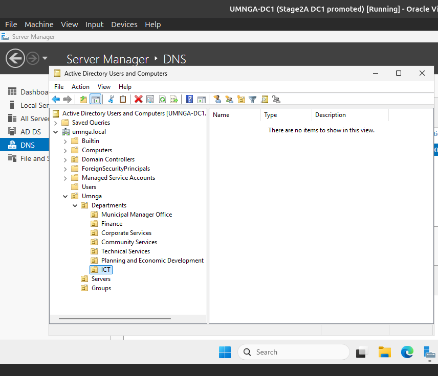

## Design decisions

1. I kept umnga.local as the domain name. It is an isolated lab and the name is short. In production this would be the wrong choice. The suffix .local is reserved for multicast DNS and cannot be verified as a custom domain in Microsoft 365 or Entra ID. A real organisation would use a subdomain of a name it owns, such as ad.example.org.
2. DNS runs on the domain controller. Active Directory finds its services through DNS records, and installing DNS during promotion creates the right zones.
3. SVR1 and CORE1 use only 192.168.20.10 as their DNS server. A public DNS server cannot answer questions about umnga.local, and a mixed list makes domain lookups fail at random.
4. One top OU named Umnga with three children: Departments, Servers and Groups. Policy and delegated admin rights attach to OUs, so users, servers and groups need separate places. The default Users and Computers containers cannot have policy linked to them.
5. One OU per department, named exactly as the department, so the structure matches the organisation chart.
6. Security groups use the prefix GG_ plus the department, with type Security and scope Global. Only security groups can receive permissions, and the name tells an administrator the scope and purpose. Groups will hold permissions in later projects, and users will hold none directly.
7. User logon names are surname plus first initial, for example ndlovut, with a number added if two people would share a name.
8. New accounts get a temporary password and "User must change password at next logon", so the administrator never knows a staff member's real password. No password appears in this repository.
9. I created a DNS record by hand only for something that cannot register itself. Domain joined servers create their own records.
10. Servers go in the Servers OU and not in the default Computers container, because servers need different policy from staff computers.
11. I left the Default Domain Policy and Default Domain Controllers Policy unchanged. A mistake in them reaches every account or every domain controller. New settings go in new GPOs.
12. GPO names follow the pattern Umnga, then the target, then the purpose. The GPO is linked to OU Servers only, because the link decides its scope.
13. The GPO uses computer settings only, because there is no client computer yet to test a user setting.
14. A logon notice is the test setting. It is harmless, real organisations use it, and it can be seen directly, which shows the policy arrived.
15. I checked policy with gpresult on the machine. The console shows what was configured. gpresult shows what the machine applied.
16. FSMO roles are read only. With one domain controller there is nowhere to move a role to.
17. I took snapshots before promotion, before the join and before the first policy change, because those steps are the hardest to undo by hand.

## Implementation, phase A: directory and domain join

### A1. Install the AD DS role on DC1

Added the Active Directory Domain Services role with its management tools through Server Manager. The result page offered "Promote this server to a domain controller", because installing the role does not make the server a domain controller.

Evidence: 02a_step02_adds_role_installed_dc1.png

### A2. Promote DC1 to a new forest

Chose Add a new forest with root domain umnga.local, default functional levels, and DNS server and Global Catalog ticked. I set the Directory Services Restore Mode password and did not record it anywhere in this repository. The View script page showed the equivalent `Install-ADDSForest` command with DomainName umnga.local, DomainNetbiosName UMNGA, DomainMode and ForestMode Win2025, InstallDns true, and the default database, log and SYSVOL paths.

Observed: after the restart the sign in screen offered UMNGA\Administrator. `ipconfig /all` on DC1 listed the DNS servers as ::1 and 127.0.0.1, so DC1 asks itself, as the first domain controller should. `Get-ADDomain` returned Name umnga and DNSRoot umnga.local. NTDS, DNS and Netlogon were running. I recorded these last three checks from my notes and have no screenshot.

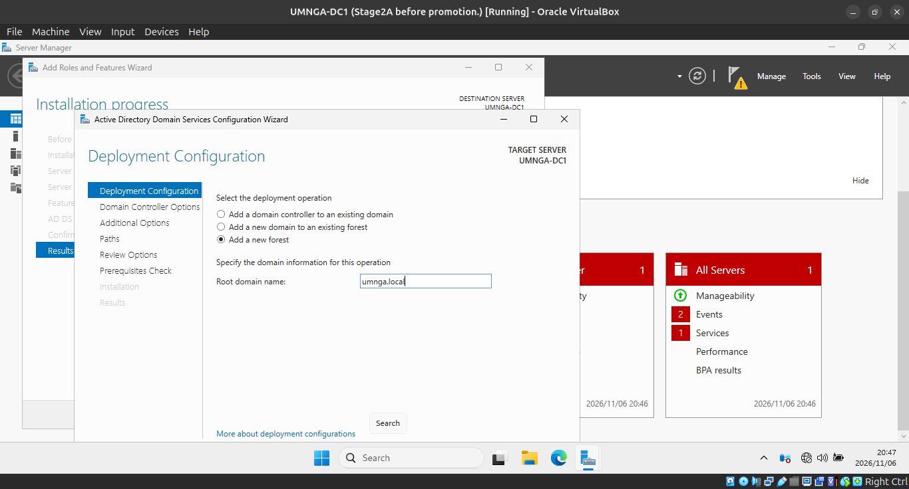

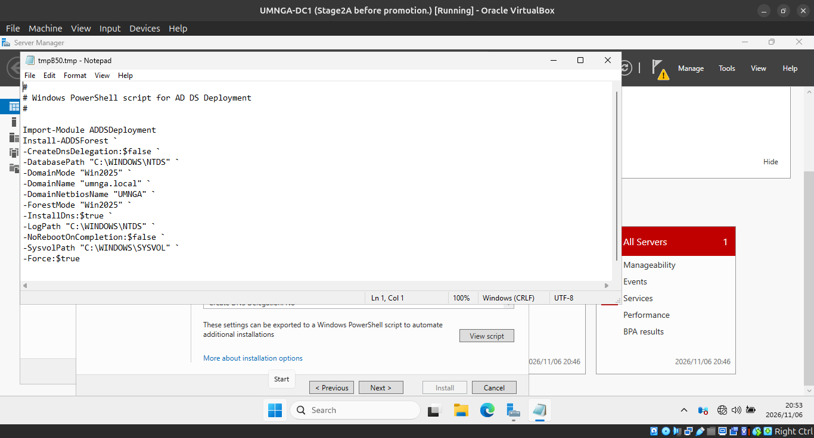

Evidence: 02a_step03_new_forest_dc1.png, 02a_step03_promotion_script_dc1.png, 02a_step03_domain_signin_dc1.png

### A3. Point SVR1 and CORE1 at DC1 for DNS

On SVR1 I set the preferred DNS server to 192.168.20.10 in the adapter properties. On CORE1 I ran `Set-DnsClientServerAddress -InterfaceAlias "Ethernet" -ServerAddresses 192.168.20.10`.

Observed: on both servers `Get-DnsClientServerAddress` showed 192.168.20.10, and `Resolve-DnsName` for umnga.local and UMNGA-DC1.umnga.local both answered 192.168.20.10.

Evidence: 02a_step04_dns_set_svr1.png, 02a_step04_dns_set_core1.png

### A4. DNS records

In DNS Manager, in the forward zone umnga.local, I created a host record UMNGA-PRN1 at 192.168.20.50 (without a PTR record at this point) and a CNAME alias dns pointing to UMNGA-DC1.umnga.local.

Observed: the zone lists both new records as static, next to the records the promotion created. From SVR1, `Resolve-DnsName` answered 192.168.20.50 for UMNGA-PRN1.umnga.local, and answered the dns alias with the target umnga-dc1.umnga.local and its address. The reverse lookup zone is built in [project 03](../03%20Core%20services).

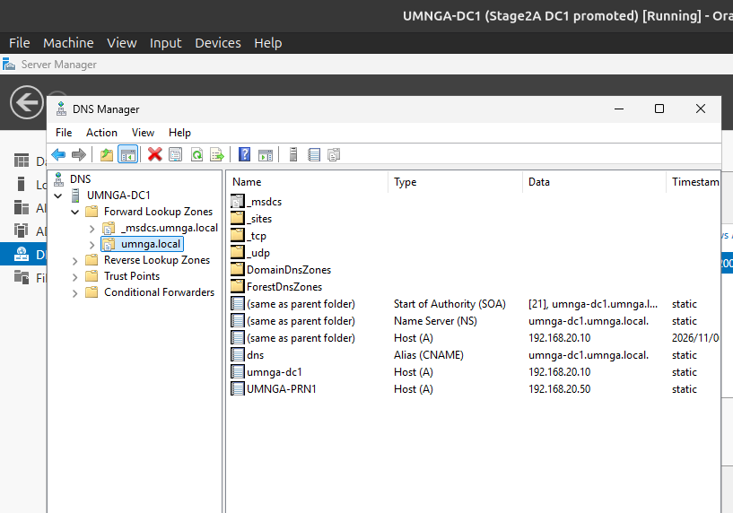

Evidence: 02a_step05_zone_records_dc1.png, 02a_step05_resolve_svr1.png

### A5. Organizational units

Created Umnga, then Departments, Servers and Groups inside it, then the seven department OUs inside Departments, with "Protect container from accidental deletion" ticked. The equivalent is `New-ADOrganizationalUnit -Name "Finance" -Path "OU=Departments,OU=Umnga,DC=umnga,DC=local"`.

Observed: `Get-ADOrganizationalUnit` returned 12 rows. That is the 11 OUs I planned plus the built in Domain Controllers OU that promotion creates.

Evidence: 02a_step06_ou_tree_dc1.png

### A6. Security groups

Created seven groups in OU Groups, each with type Security and scope Global: GG_MunicipalManagerOffice, GG_Finance, GG_CorporateServices, GG_CommunityServices, GG_TechnicalServices, GG_PlanningEconomicDev and GG_ICT.

Observed: the Groups OU lists seven groups and the Type column reads Security Group, Global for all of them. The screenshot truncates five of the names, so I took the full spelling from my plan.

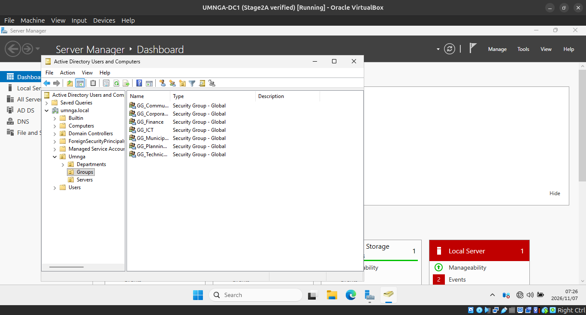

Evidence: 02a_step07_groups_dc1.png

### A7. Users and group membership

Created one invented user in each department OU, with a temporary password and "User must change password at next logon", and added each to the department group.

| Name | Logon | OU | Group |
|---|---|---|---|
| Thabo Ndlovu | ndlovut | Finance | GG_Finance |
| Nomsa Duka | dukan | Municipal Manager Office | GG_MunicipalManagerOffice |
| Aisha Naidoo | naidooa | Corporate Services | GG_CorporateServices |
| Pieter Jacobs | jacobsp | Community Services | GG_CommunityServices |
| Sipho Mabuza | mabuzas | Technical Services | GG_TechnicalServices |
| Zanele Pillay | pillayz | Planning and Economic Development | GG_PlanningEconomicDev |
| Lungile Dube | dubel | ICT | GG_ICT |

All names are invented.

Observed: `Get-ADUser` on the Departments OU returned seven rows, each user in the OU of its department. The Member Of tab of Thabo Ndlovu shows Domain Users and GG_Finance.

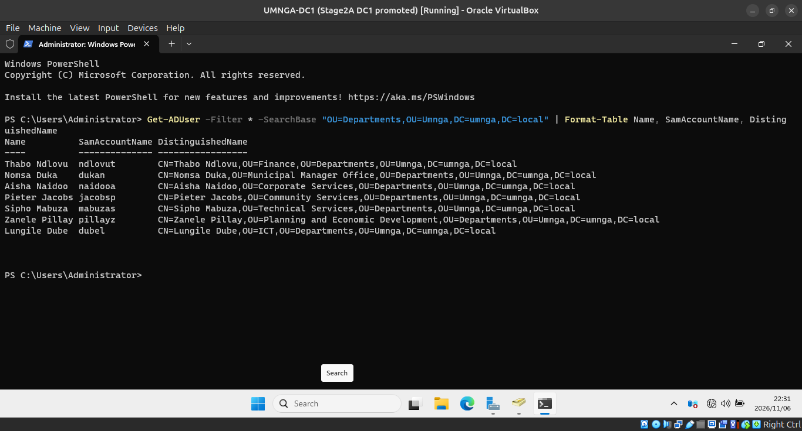

Evidence: 02a_step08_users_dc1.png, 02a_step08_first_user_dc1.png

### A8. Join SVR1 and CORE1 to the domain

On SVR1 I used Server Manager, Local Server, Change, Domain umnga.local, signed in as UMNGA\Administrator, then moved the computer account to OU Servers on DC1. CORE1 was joined from PowerShell with the target OU in the command (`Add-Computer -DomainName umnga.local -OUPath "OU=Servers,OU=Umnga,DC=umnga,DC=local" -Credential UMNGA\Administrator -Restart`). I did not record the exact method used on CORE1.

Observed: the welcome message appeared on SVR1. After the restart, `Win32_ComputerSystem` showed Domain umnga.local and PartOfDomain True, `whoami` showed umnga\administrator, and `Get-ADComputer` on DC1 showed SVR1 in OU Servers. UMNGA-SVR1.umnga.local resolved to 192.168.20.11, so the server registered its own DNS record. Active Directory Users and Computers shows UMNGA-CORE1 and UMNGA-SVR1 together in OU Servers. I recorded the CORE1 checks from my notes.

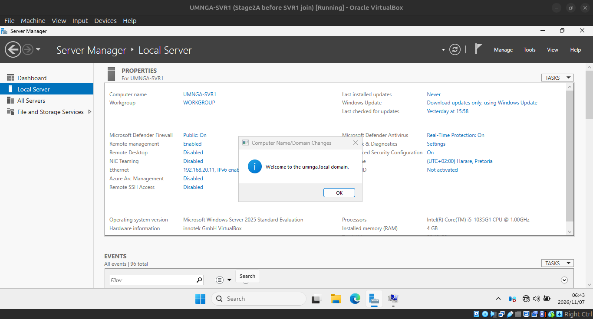

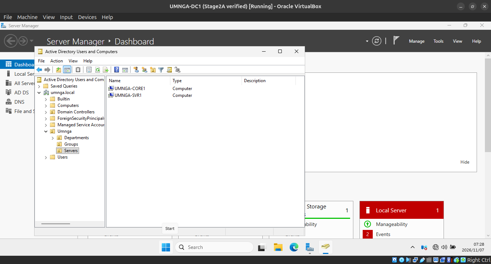

Evidence: 02a_step09_join_welcome_svr1.png, 02a_step09_computers_ou_dc1.png, 02a_step10_servers_ou_dc1.png

## Implementation, phase B: Group Policy and FSMO roles

### B1. Review the existing policy

In Group Policy Management on DC1 I read the links of each GPO. Two GPOs existed: the Default Domain Policy linked to umnga.local, and the Default Domain Controllers Policy linked to OU Domain Controllers. No OU in the Umnga tree had a policy linked. I recorded this from my notes.

### B2. Create and link the logon notice GPO

Created the GPO Umnga Servers Logon Notice with "Create a GPO in this domain, and Link it here" on OU Servers. In its Computer Configuration, under Security Options, I set the interactive logon message title to "Umnga ICT Notice" and the message text to "Umnga Local Municipality. Authorised use only. Activity may be monitored."

Observed: OU Servers lists the GPO under Linked Group Policy Objects with link order 1, Enforced No, Link Enabled Yes and GPO Status Enabled. The Settings tab shows both interactive logon settings and "No settings defined" under User Configuration.

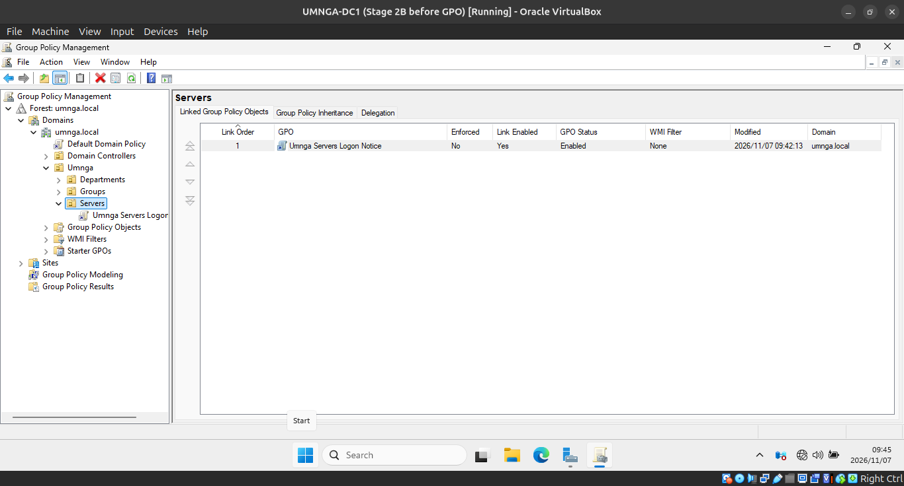

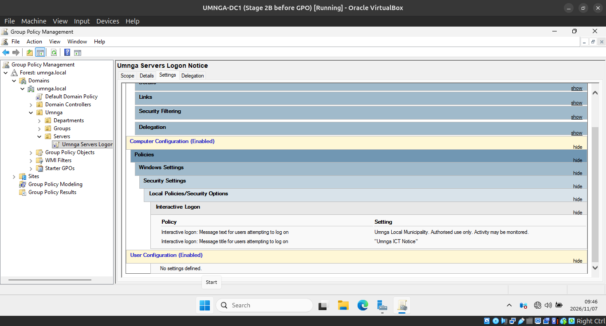

Evidence: 02b_step02_gpo_linked_servers_dc1.png, 02b_step02_gpo_settings_dc1.png

### B3. Check that the policy applies

Ran `gpupdate /force` and `gpresult /scope computer /r` on SVR1 and CORE1. On SVR1 the notice appeared at the sign in screen after a sign out, with no restart.

Observed: on CORE1 gpresult shows the computer account in OU=Servers,OU=Umnga,DC=umnga,DC=local, the policy applied from UMNGA-DC1.umnga.local, and two applied GPOs: Umnga Servers Logon Notice and Default Domain Policy. The empty Local Group Policy is listed as filtered out, which is normal. I recorded the SVR1 result from my notes and the notice screenshot.

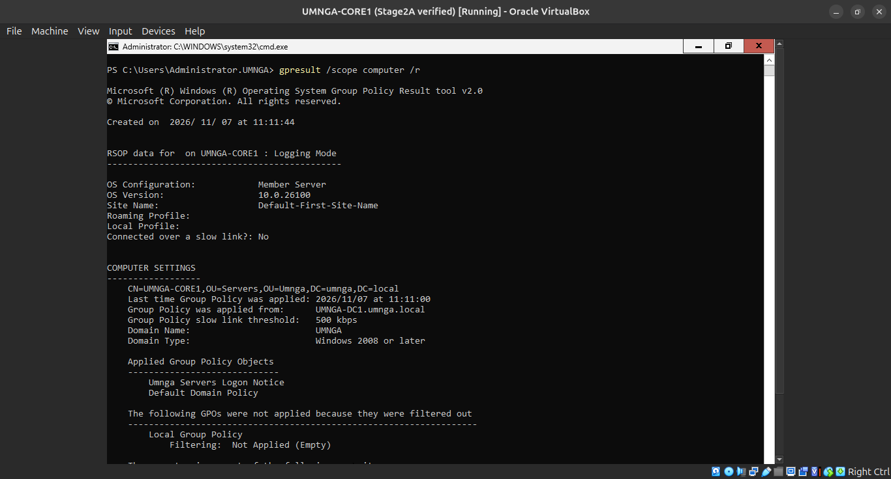

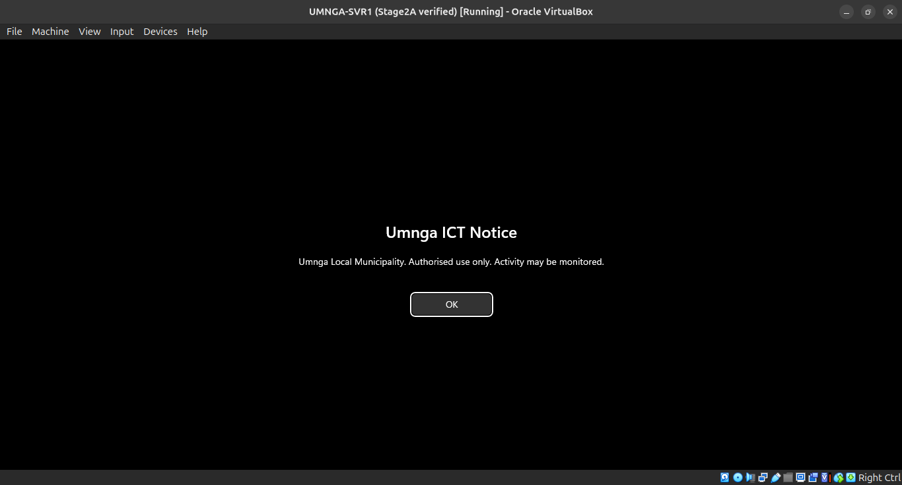

Evidence: 02b_step03_gpresult_core1.png, 02b_step03_logon_notice_svr1.png

### B4. FSMO roles

Ran `netdom query fsmo`. The Schema master, Domain naming master, PDC, RID pool manager and Infrastructure master are all on UMNGA-DC1.umnga.local. With one domain controller I can read the roles but not move them.

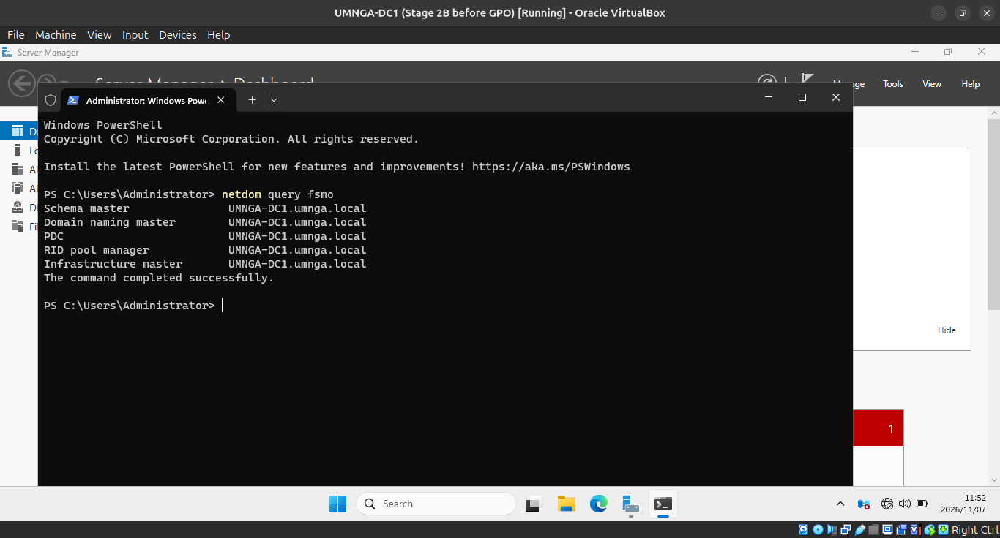

Evidence: 02b_step04_fsmo_roles_dc1.png

## Verification

1. DC1 is a domain controller for umnga.local, NTDS, DNS and Netlogon run, and sign in works as UMNGA\Administrator.
2. SVR1 and CORE1 use 192.168.20.10 for DNS and resolve umnga.local and UMNGA-DC1.umnga.local.
3. The A record UMNGA-PRN1 and the alias dns resolve from SVR1.
4. The OU structure exists, seven global security groups exist, and seven users sit in their department OUs.
5. SVR1 and CORE1 are joined and sit in OU Servers, and each registered its own DNS record.
6. Umnga Servers Logon Notice is linked to OU Servers and enabled. gpresult on CORE1 lists it as applied, and the notice appeared on SVR1.
7. UMNGA-DC1 holds all five FSMO roles.

## Limitations

1. The reverse lookup zone was not part of this project. I added it in project 03.
2. I did not record the Prerequisites Check warnings shown during promotion, and I did not capture the group member counts.
3. There is no screenshot of the SVR1 gpresult output or of the CORE1 sign in screen with the notice.
4. I did not test user settings in Group Policy, because there is no client computer yet.
5. I did not practise moving or seizing a FSMO role, because the domain has one domain controller.
6. I did not find the cause of an intermittent "Error when launching" message on PowerShell and cmd. See the troubleshooting log.

## Files

1. [Captions](evidence/Captions.md)
2. [Troubleshooting log](Troubleshooting%20log.md)
3. [Naming and IP standard](../docs/Naming%20and%20IP%20standard.md)
