# 03 Core services: DHCP, IIS and Remote Desktop Services

Status: complete (7 November 2026)
Deliverable: Umnga Core Services
Builds on: [02 Identity and policy](../02%20Identity%20and%20policy)
Next project: [04 Departmental file server](../04%20Departmental%20file%20server)

## Scenario

Umnga's domain has servers, groups and policy, but every address is still typed by hand, there is no internal web page, and nobody can use a server desktop without sitting at the machine. ICT wants three everyday services: devices that get an address by themselves, a page staff can reach by a friendly name, and a way for authorised staff to open a session on a server from another computer.

## Objectives

1. Close a gap left in project 02 by building the reverse lookup zone, so an address can be turned back into a name.
2. Install DHCP on UMNGA-SVR1, authorise it in Active Directory, create a scope for 192.168.20.100 to .199 with the DNS options, and show that a device receives a lease.
3. Install IIS on UMNGA-SVR1 and publish a simple internal page that other servers reach by name, including an alias called intranet.
4. Deploy Remote Desktop Services on UMNGA-SVR1, allow only the ICT group, and open a real session from DC1 as an ICT user.

## State at the end of the project

1. DC1 has a reverse lookup zone 20.168.192.in-addr.arpa with PTR records for 192.168.20.10, .11 and .12.
2. UMNGA-SVR1 runs the DHCP server, authorised in Active Directory. The scope Umnga Staff Devices on 192.168.20.0 has the pool 192.168.20.100 to .199, the DNS server option 192.168.20.10 and the DNS domain name option umnga.local. There is no router option, because UmngaNet has no gateway.
3. A temporary test client (UMNGA-TMP1) received 192.168.20.100 from 192.168.20.11. It was a Windows Setup environment, not an installed or domain joined client, and it is switched off.
4. UMNGA-SVR1 also runs IIS. A page called index.html sits in the default content folder. Both http://UMNGA-SVR1.umnga.local and http://intranet.umnga.local show it from DC1. The alias intranet is a CNAME record that points to UMNGA-SVR1.umnga.local.
5. UMNGA-SVR1 runs Remote Desktop Services as a single server session deployment, with the Connection Broker, Session Host and Web Access on it. The collection QuickSessionCollection allows only UMNGA\GG_ICT. UMNGA\dubel signed in from DC1, `whoami` returned umnga\dubel and `hostname` returned UMNGA-SVR1.

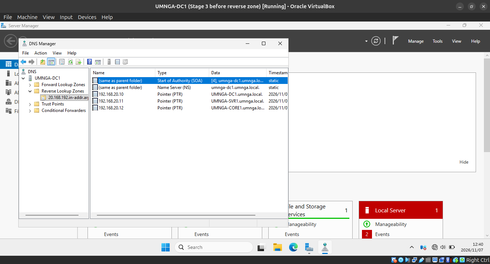

## Design decisions

1. I built the reverse zone first. It makes addresses readable as names in lookups, logs and DHCP lease lists.
2. DHCP runs on UMNGA-SVR1 and not on the domain controller, so the one domain controller only does directory and DNS work.
3. The scope is 192.168.20.100 to .199. That is the range reserved in the address plan, and it keeps the low addresses free for servers and devices with fixed addresses, so the two never clash.
4. The scope hands out only the DNS server and the DNS domain name, and no router. Domain members must find the domain controller for DNS, and UmngaNet has no gateway to hand out.
5. The DHCP server is authorised in Active Directory. A domain refuses to let an unauthorised DHCP server hand out addresses, which stops a stray server from giving out wrong ones.
6. I tested DHCP with a real request and not by reading the console. A scope that looks right proves nothing until a device gets a lease from it.
7. I used the Windows Server Setup environment as the temporary client, because there was no disk space for a fourth installed machine and Setup asks DHCP for an address by itself. This shows the scope can lend an address. It does not show that a domain joined client works.
8. IIS has the default role services only. Fewer services means a smaller attack surface.
9. I published a plain page called index.html and added a CNAME alias intranet. An alias named for the function means staff keep one address if the page moves to another server.
10. I deployed RDS with Quick Start on one server. The lab has three servers and one is the domain controller, so the roles share UMNGA-SVR1. A real organisation would spread them.
11. Only the group GG_ICT is allowed in the collection. Access goes to a group and not to named people. I removed the default group so that only the ICT team can sign in.
12. I took a snapshot before each change, because the project changes DNS, adds three roles and restarts a server.

## Implementation

### 1. Reverse lookup zone and PTR records

On DC1, in DNS Manager, I created a primary reverse zone stored in Active Directory for network ID 192.168.20, with secure dynamic updates only. The equivalent is `Add-DnsServerPrimaryZone -NetworkId "192.168.20.0/24" -ReplicationScope Domain -DynamicUpdate Secure`.

Observed: the zone 20.168.192.in-addr.arpa lists PTR records for 192.168.20.10 (UMNGA-DC1.umnga.local), .11 (UMNGA-SVR1.umnga.local) and .12 (UMNGA-CORE1.umnga.local). At first the zone showed only the Start of Authority and Name Server records, and refreshing the zone view made the three records appear. `nslookup` on DC1 returned UMNGA-CORE1.umnga.local for 192.168.20.12 and UMNGA-SVR1.umnga.local for 192.168.20.11.

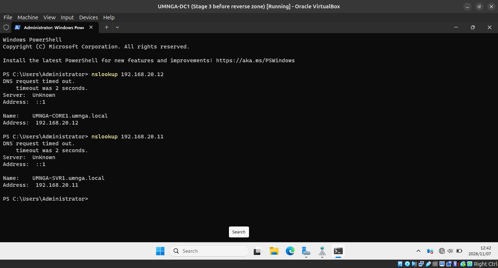

Evidence: 03_step01_reverse_zone_ptr_dc1.png, 03_step01_nslookup_ptr_dc1.png

### 2. DHCP on UMNGA-SVR1

Added the DHCP Server role and completed the post install configuration with the domain administrator account, which creates the two DHCP security groups and authorises the server. Created a scope named Umnga Staff Devices from 192.168.20.100 to 192.168.20.199, mask length 24, no exclusions, default lease. Set the domain name to umnga.local and the DNS server to 192.168.20.10, left the router blank, and activated the scope.

Observed: the role installed without a restart, the wizard reported that authorisation completed, and the IPv4 node shows a green arrow. The console shows scope [192.168.20.0] Umnga Staff Devices with the pool .100 to .199, scope option 006 DNS Servers 192.168.20.10 and option 015 DNS Domain Name umnga.local, and no 003 Router option. I recorded the install and authorisation from my notes.

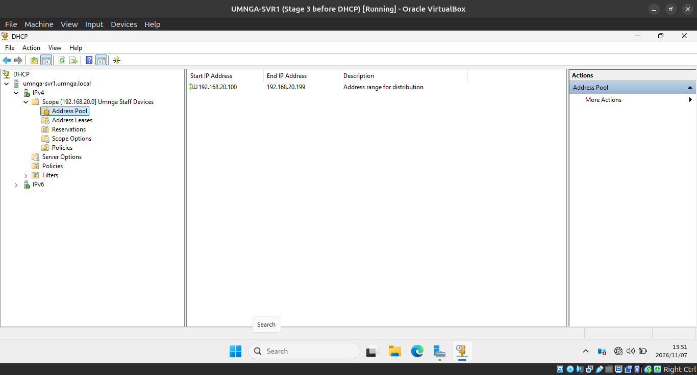

Evidence: 03_step02_dhcp_address_pool_svr1.png, 03_step02_dhcp_scope_options_svr1.png

### 3. Test DHCP with a temporary client

Created a virtual machine UMNGA-TMP1 with 2 GB of memory, the Windows Server ISO in its optical drive and Adapter 1 on UmngaNet. I booted it from the CD into the Windows Server Setup screen without installing, opened a command prompt with Shift+F10, ran `wpeinit` to start the network card, and then ran `ipconfig /all`.

Observed: the client received IPv4 address 192.168.20.100 from DHCP server 192.168.20.11, with DNS server 192.168.20.10, DNS suffix umnga.local, mask 255.255.255.0, no default gateway, and a lease from 7 November 2026 4:38 PM to 15 November 2026 4:38 PM. Setup generated its host name (minint-fo3m6a9). The address and lease appeared only after `wpeinit`. The Address Leases list on SVR1 shows the lease for 192.168.20.100 under that name. I blurred the MAC address in the client screenshot.

Limit: this was a Setup environment, not an installed Windows client, and it was not joined to the domain.

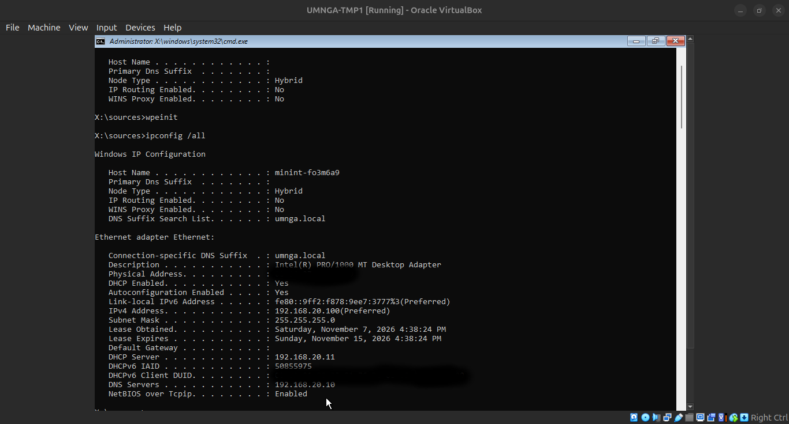

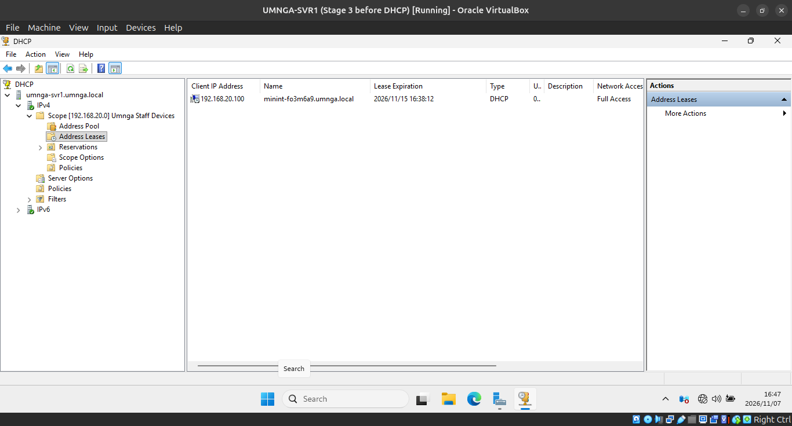

Evidence: 03_step03_ipconfig_lease_tmp1.png, 03_step03_dhcp_lease_list_svr1.png

### 4. IIS and an internal page

Added the Web Server (IIS) role with the default role services, confirmed the welcome page at http://localhost, and saved a page named index.html in C:\inetpub\wwwroot, which IIS serves before iisstart.htm. On DC1 I added a CNAME record intranet pointing to UMNGA-SVR1.umnga.local and browsed to both names.

Observed: the welcome page showed at http://localhost, the Umnga page replaced it, and both http://UMNGA-SVR1.umnga.local and http://intranet.umnga.local showed the Umnga page from DC1. The browser shows Not secure, because the page uses plain HTTP. I recorded the role installation result from my notes.

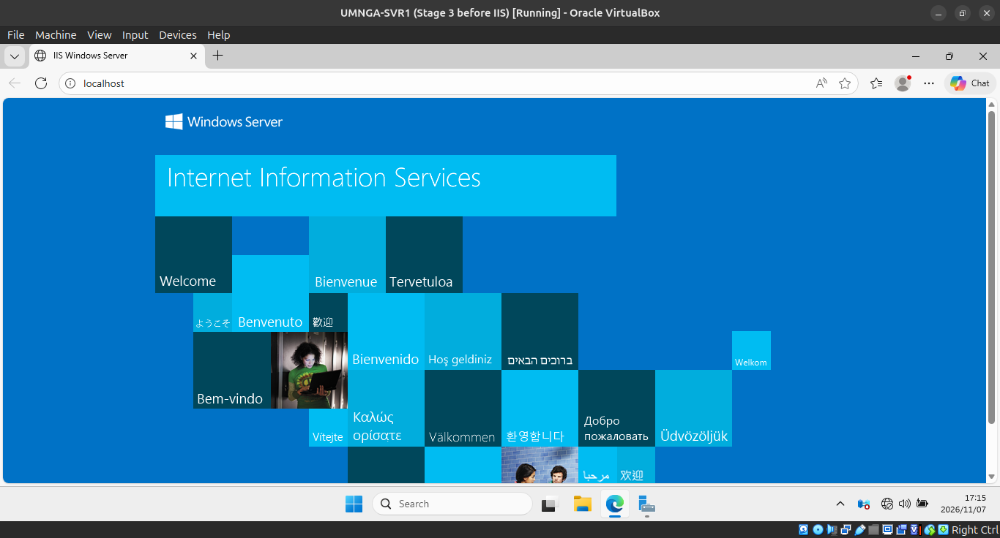

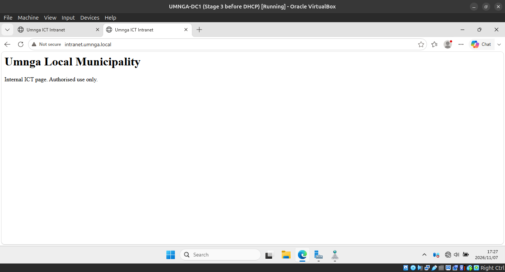

Evidence: 03_step04_iis_welcome_page_svr1.png, 03_step04_umnga_page_by_name_dc1.png

### 5. Remote Desktop Services

Used Add Roles and Features, Remote Desktop Services installation, Quick Start, Session based desktop deployment on SVR1, and allowed the restart. In the collection properties I removed the default user group and added GG_ICT. From DC1 I ran `mstsc`, connected to UMNGA-SVR1.umnga.local and signed in as UMNGA\dubel, the invented ICT user. In the session I ran `whoami` and `hostname`.

Observed: the deployment succeeded and SVR1 restarted. The Overview names UMNGA-SVR1.UMNGA.LOCAL as the RD Connection Broker server, and the Deployment Servers list shows RD Connection Broker, RD Session Host and RD Web Access, all on SVR1. RD Gateway and RD Licensing show as not added. The collection is QuickSessionCollection and its user groups list shows only UMNGA\GG_ICT. The remote session ran as umnga\dubel and `hostname` returned UMNGA-SVR1. Two sign in errors came up on the way, and they are in the troubleshooting log.

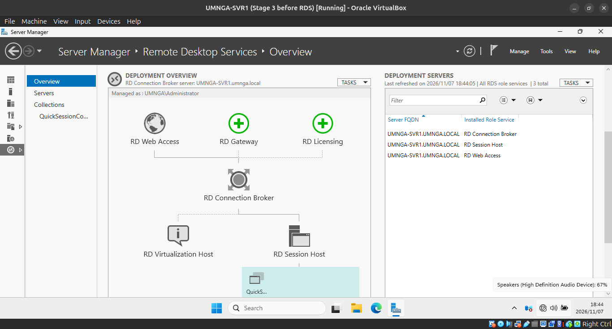

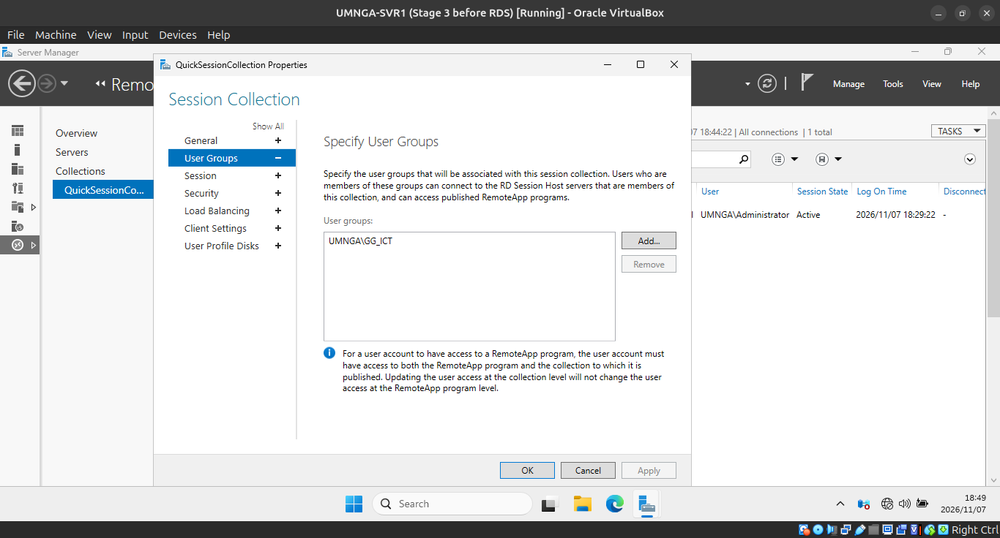

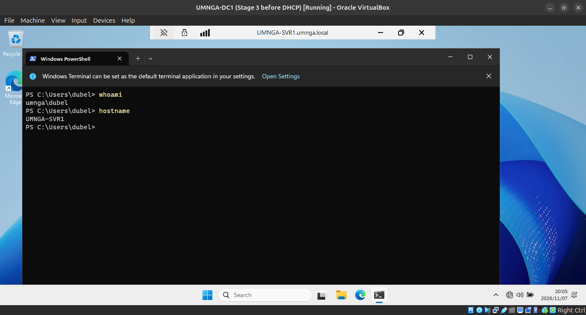

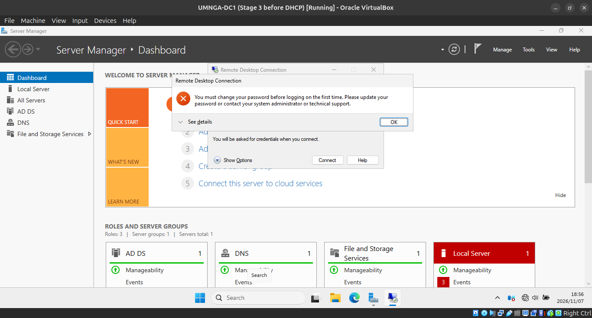

Evidence: 03_step05_rds_overview_svr1.png, 03_step05_rds_collection_users_svr1.png, 03_step05_rdp_session_dc1.png, 03_step05_rdp_password_change_error_dc1.png

## Verification

1. The reverse zone lists PTR records for .10, .11 and .12, and `nslookup` returns names for .11 and .12.
2. DHCP on SVR1 has the scope Umnga Staff Devices with the pool .100 to .199 and options 006 and 015, and no router option.
3. A test client received 192.168.20.100 from 192.168.20.11 with DNS 192.168.20.10, and SVR1 lists the lease.
4. IIS shows the Umnga page by the server name and by the alias intranet from DC1.
5. RDS is deployed on SVR1, the collection allows only GG_ICT, and UMNGA\dubel opened a session from DC1.
6. The title bars show these snapshots: DC1 "Stage 3 before reverse zone" and "Stage 3 before DHCP", and SVR1 "Stage 3 before DHCP", "Stage 3 before IIS" and "Stage 3 before RDS".

## Limitations

1. I did not test DHCP with a domain joined Windows client. The test client was a Setup environment.
2. I did not create a DHCP reservation, an exclusion or failover.
3. I did not capture the reverse zone's replication scope and dynamic update setting in a screenshot.
4. I did not test IIS over HTTPS, and I did not inspect the IIS firewall rule.
5. I did not deploy RD Licensing or check the licensing grace period, and I did not test RD Web Access or RemoteApp programs. I tested only one user.
6. I did not diagnose the cause of the "not authorised" message that blocked an RDS sign in. See the troubleshooting log.

## Files

1. [Captions](evidence/Captions.md)
2. [Troubleshooting log](Troubleshooting%20log.md)
3. [Naming and IP standard](../docs/Naming%20and%20IP%20standard.md)
