# 04 Departmental file server: Storage Spaces, shares and permissions

Status: complete (8 November 2026)
Deliverable: Umnga Departmental File Server
Builds on: [03 Core services](../03%20Core%20services), [02 Identity and policy](../02%20Identity%20and%20policy)
Next project: [05 Onboarding automation](../05%20Onboarding%20automation)

## Scenario

Umnga's seven departments keep their documents wherever they can, on desktops and in e mail. Nobody can say who may open what, and a file lost with a machine is gone. ICT wants one place where each department has its own folder, where only that department's staff can open it, and where the storage underneath keeps a second copy of the data.

## Objectives

1. Look at the disks on UMNGA-SVR1 and name the layers: disk, partition, volume and file system.
2. Add three blank 5 GB disks, build a Storage Spaces pool, create a mirrored, thin provisioned virtual disk from it, and format it as an NTFS volume.
3. Install the File Server role on UMNGA-SVR1.
4. Create one folder and one share for each of the seven departments, and let only that department's group in, using NTFS permissions for the real restriction.
5. Test the result for an allowed user and a blocked user.

## State at the end of the project

1. UMNGA-SVR1 has the system disk (Disk 0, 60 GB, MBR) and three extra 5 GB virtual disks, all in a storage pool called Umnga Pool. Server Manager shows the pool capacity as 13.5 GB.
2. The pool holds one virtual disk called Departments: a mirror, thin provisioned, 5 GB, OK and Healthy. It appears as Disk 4, GPT and Online, with one NTFS volume labelled Departments on drive E: (4.98 GB).
3. The File Server role service is installed on UMNGA-SVR1.
4. E: holds seven folders: MunicipalManagerOffice, Finance, CorporateServices, CommunityServices, TechnicalServices, PlanningEconomicDev and ICT. Each is shared by its own name with access based enumeration on.
5. Every folder has inheritance turned off and lists only CREATOR OWNER, SYSTEM, Administrators and its own group, for example UMNGA\GG_Finance with Modify. No Users, Authenticated Users or Everyone entry remains on any folder.
6. An effective access check on E:\Finance gave Modify level access to a Finance user and no access to a Planning user. This calculates NTFS permissions only. It was not a real sign in.
7. The built in administrative share E$ also exists, because Windows creates one for every drive. I did not create it.

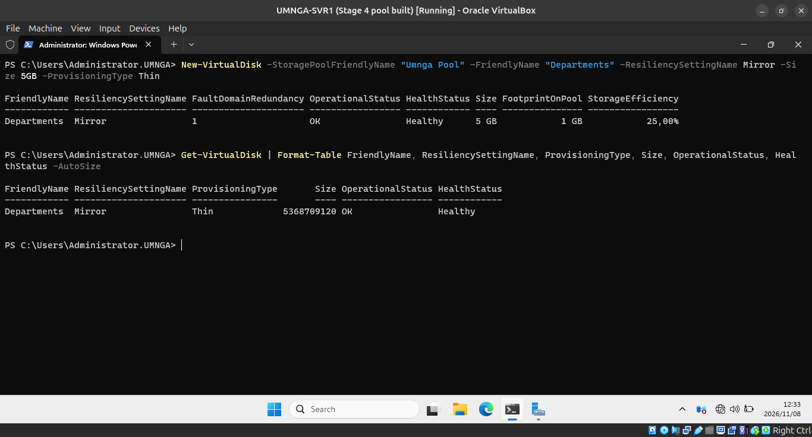

## Design decisions

1. I added three blank 5 GB virtual disks and left them uninitialised. Storage Spaces only offers disks with no partition table, and small disks save space on the host laptop.
2. A pool of three disks and a mirror from it. A mirror keeps two copies of the data. All three virtual disks are files on one laptop drive, so the mirror shows the design and gives no real protection.
3. Thin provisioning. The pool hands out space as it is used. The virtual disk is 5 GB and shows a footprint on the pool of 1 GB.
4. NTFS for the volume, because it carries the file permissions this project is about.
5. I used PowerShell for the pool, the virtual disk and the volume. The pool wizard offered only one of the three disks and the New Volume wizard listed no virtual disks, although PowerShell saw everything. The disks all show the same UniqueId, which is the probable cause. I did not test it.
6. One folder per department, named like the group, for example Finance for GG_Finance. The name tells an administrator which group belongs to the folder, and a script can loop over the names.
7. A broad share permission (Everyone, Full control) and a strict NTFS list. When both apply, the stricter one wins, so one broad share permission plus one strict NTFS list means a single place to manage.
8. Access based enumeration on every share, so staff see only the folders they can open.
9. Permissions go to the GG_ groups and never to people, so a change of department is only a group membership change.
10. Modify and not Full control for each group. Members can add, change and delete files but cannot change permissions or take ownership.
11. Inheritance is off on each folder, with the Users and Authenticated Users entries removed, because the drive's default entries would let any signed in user read every folder.
12. SYSTEM and Administrators stay on every folder, so the server and its administrators can always manage the data.
13. I tested with the Effective Access tab. It needs no user passwords and no client computer. It works out NTFS permissions only.
14. I built Finance by hand, then the other six with one PowerShell loop, which repeats identical settings and avoids typing the same steps six times.

## Implementation

### 1. Disks

Read Disk Management on SVR1. Disk 0 is Basic, 60 GB and Online, with three partitions: a 100 MB NTFS system partition, C: at 59.13 GB NTFS with 42.62 GB free, and a 786 MB recovery partition. A later `Get-Disk` shows Disk 0 as MBR.

Evidence: 04_step01_disk_management_svr1.png

### 2. Storage pool, virtual disk and volume

With SVR1 powered off, I added three new 5 GB dynamically allocated VDI disks in VirtualBox. I pooled them, created a mirrored thin virtual disk and formatted it, all in PowerShell. `New-StoragePool` made Umnga Pool, and I did not capture its output. Then `New-VirtualDisk -FriendlyName "Departments" -ResiliencySettingName Mirror -Size 5GB -ProvisioningType Thin`, then `Initialize-Disk`, `New-Partition` and `Format-Volume` in one pipeline with GPT, drive letter E, NTFS and the label Departments.

Observed:

1. Before the pool, `Get-PhysicalDisk` lists disk 0 (60 GB, CanPool False, Insufficient Capacity) and disks 1, 2 and 3 (5 GB each, CanPool True). `Get-Disk` shows disk 0 as MBR and disks 1 to 3 as RAW and Online.
2. After the pool, `Get-PhysicalDisk -StoragePool "Umnga Pool"` lists disks 1, 3 and 2, all with the same UniqueId, ATAVBOX HARDDISK. Server Manager shows Umnga Pool at 13.5 GB with 12.7 GB free, and its physical disk list shows only one row.
3. `New-VirtualDisk` returned Departments, Mirror, OK, Healthy, 5 GB, with a footprint on the pool of 1 GB. `Get-VirtualDisk` shows ProvisioningType Thin.
4. Before formatting, `Get-Disk` showed disk 4 Departments as RAW, Offline. After formatting, it shows GPT, Online. `Get-Volume` shows E: labelled Departments, NTFS, Healthy, 5350879232 bytes with 5325115392 free.

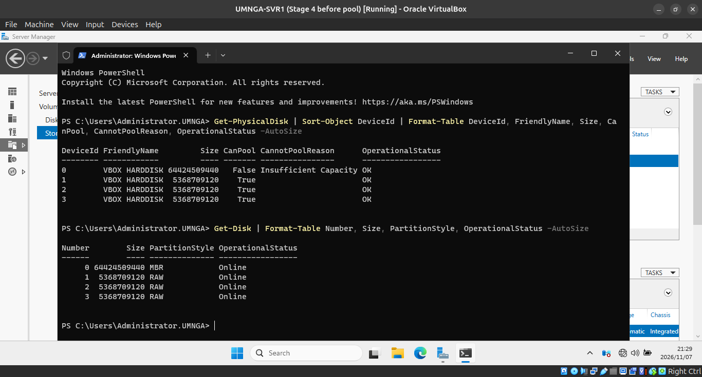

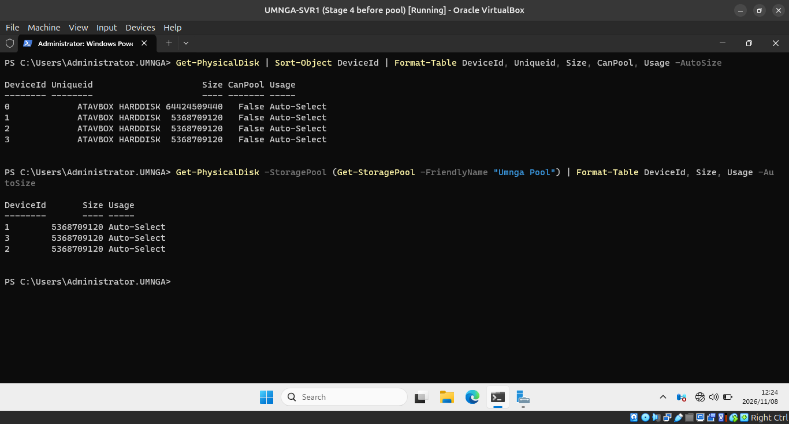

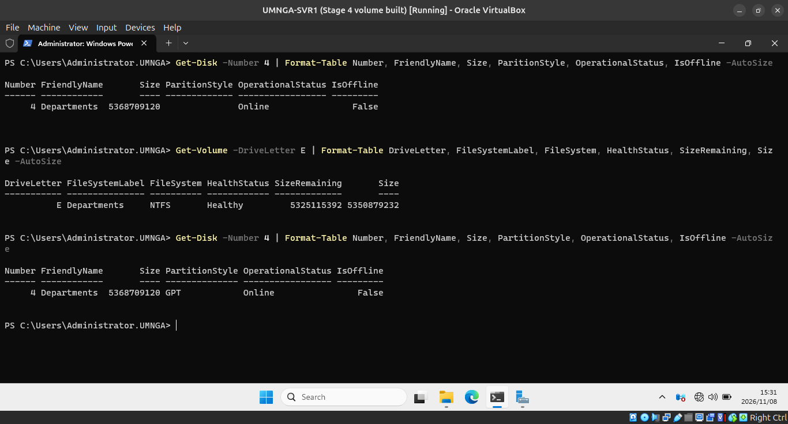

Evidence: 04_step02_physicaldisks_before_pool_svr1.png, 04_step02_pool_powershell_svr1.png, 04_step02_storage_pool_svr1.png, 04_step02_virtual_disk_svr1.png, 04_step02_volume_powershell_svr1.png, 04_step02_volume_svr1.png, 04_step02_departments_drive_svr1.png

### 3. File Server role

Added the File Server role service through Add Roles and Features, role based installation. The Results page reads "Installation succeeded on UMNGA-SVR1.umnga.local" and lists File and Storage Services, File and iSCSI Services and File Server, with no restart message.

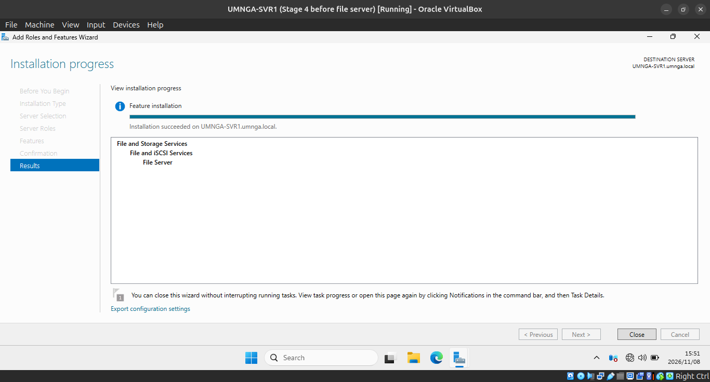

Evidence: 04_step03_file_server_role_svr1.png

### 4. Folders, shares and permissions

Created seven folders on E:. Created the Finance share by hand in Server Manager (SMB Share Quick, access based enumeration on), turned inheritance off on the Finance folder, converted the inherited entries to explicit ones, removed Users and Authenticated Users, and gave GG_Finance Modify on this folder, subfolders and files. Then I created the other six shares and permissions with one loop, typed at the prompt and not saved as a file:

```powershell
$depts = "MunicipalManagerOffice","CorporateServices","CommunityServices","TechnicalServices","PlanningEconomicDev","ICT"
foreach ($d in $depts) {
    New-SmbShare -Name $d -Path "E:\$d" -FolderEnumerationMode AccessBased -FullAccess "Everyone"
    icacls "E:\$d" /inheritance:d | Out-Null
    icacls "E:\$d" /remove "Authenticated Users" "BUILTIN\Users" | Out-Null
    icacls "E:\$d" /grant "UMNGA\GG_${d}:(OI)(CI)M" | Out-Null
}
```

Observed:

1. E: lists seven folders with the names above.
2. The Shares page lists the Finance share with local path E:\Finance and protocol SMB.
3. The advanced security list for E:\Finance shows Administrators and SYSTEM with Full control, CREATOR OWNER with Full control on subfolders and files only, and GG_Finance with Modify. Every entry is inherited from None, and the Enable inheritance button is offered, which shows inheritance is off.
4. Effective access for a Finance user: Full control, Delete subfolders and files, Change permissions and Take ownership are crossed out and every other item is ticked. That is the Modify level.
5. Effective access for a Planning user: all fourteen items are crossed out, with Access limited by File Permissions.
6. `Get-SmbShare` for paths under E:\ lists eight shares: the seven department shares, all AccessBased, and E$ with path E:\ and mode Unrestricted.
7. A listing of the access entries on each folder shows exactly CREATOR OWNER, NT AUTHORITY\SYSTEM, BUILTIN\Administrators and the folder's own UMNGA\GG_ group on all seven.

The two effective access screenshots do not show the user name line, because it was scrolled out of view, and a taskbar pop up covers part of each. The account names (ndlovut, a Finance user, and pillayz, a Planning user) come from my notes.

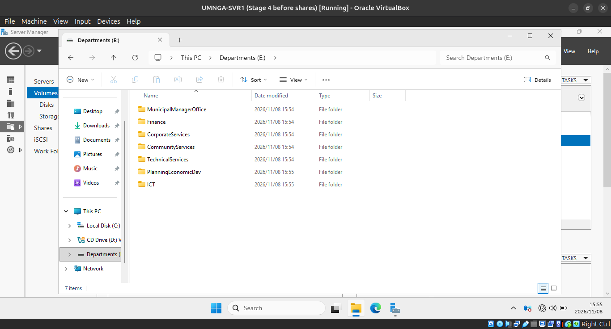

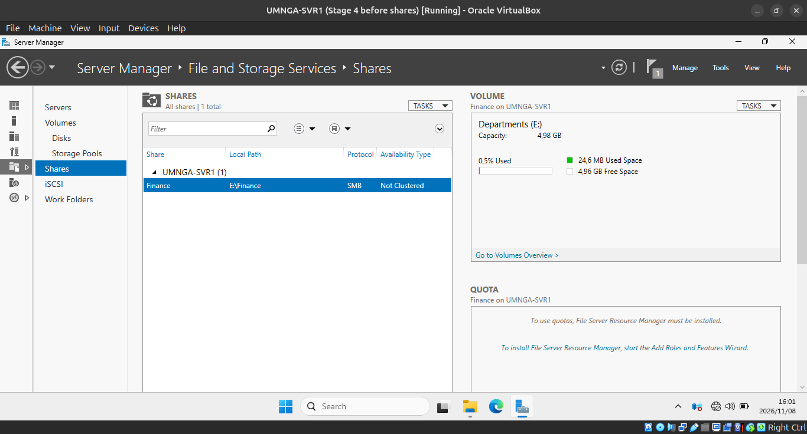

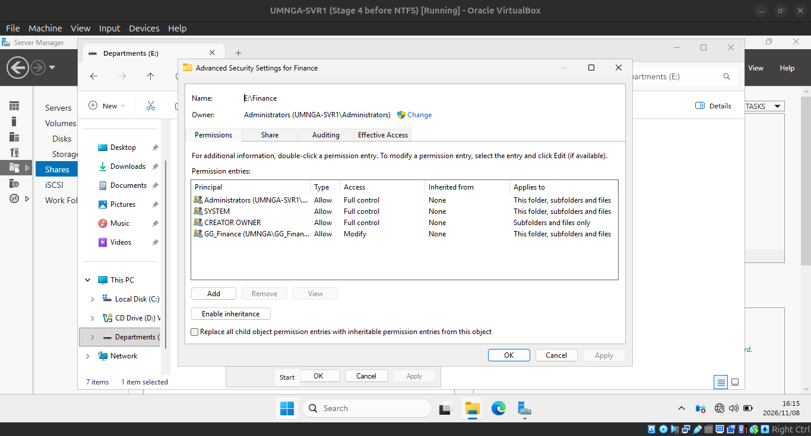

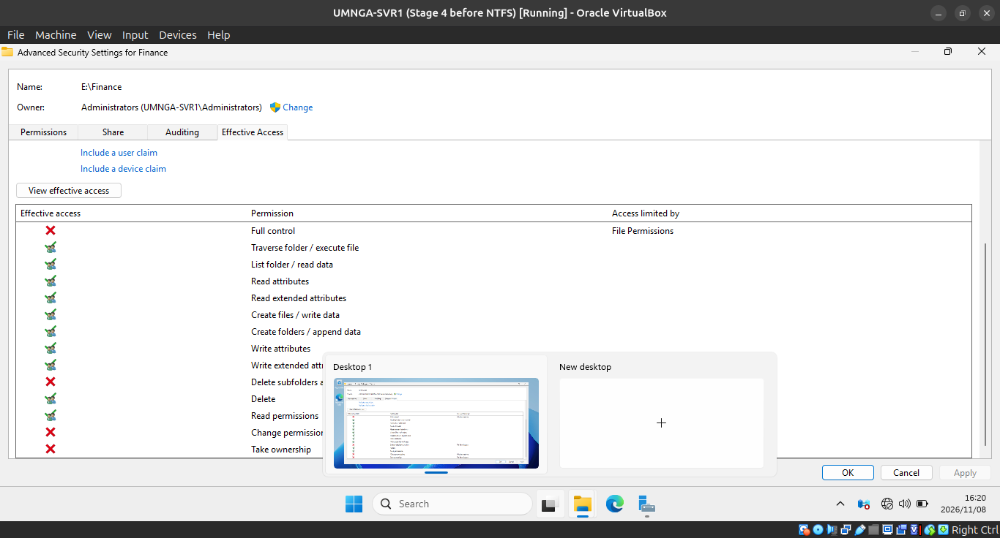

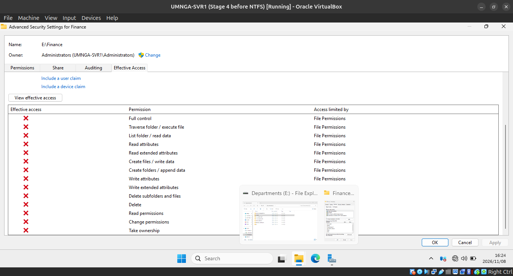

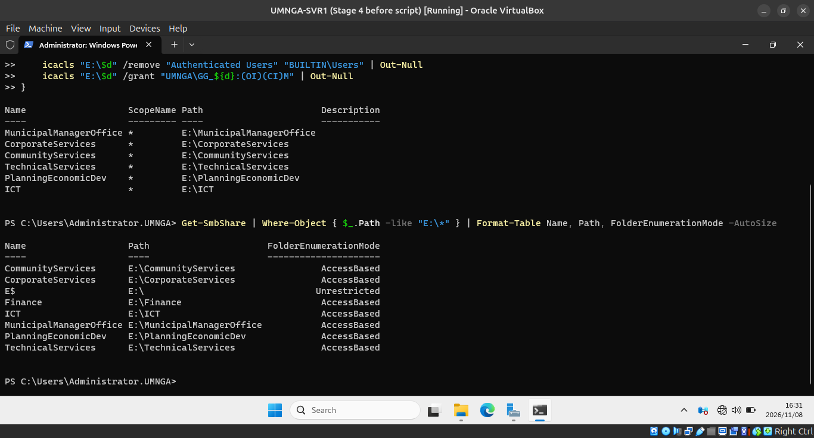

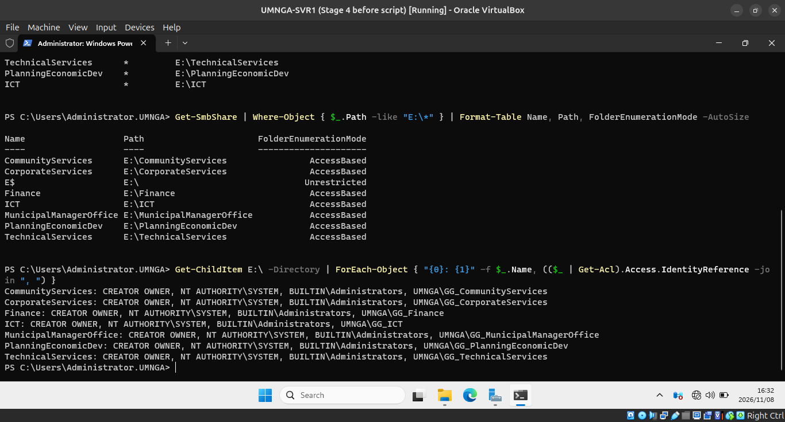

Evidence: 04_step04_department_folders_svr1.png, 04_step04_share_finance_svr1.png, 04_step04_ntfs_finance_svr1.png, 04_step04_effective_access_allowed_svr1.png, 04_step04_effective_access_blocked_svr1.png, 04_step04_all_shares_svr1.png, 04_step04_all_acls_svr1.png

## Verification

1. Disk 0 is the 60 GB system disk. Three blank 5 GB disks were added and can be pooled.
2. Umnga Pool holds three disks. The virtual disk Departments is a thin provisioned mirror, OK and Healthy.
3. Disk 4 is GPT and Online, and E: is an NTFS volume labelled Departments, Healthy.
4. The File Server role service installed without errors.
5. Seven department folders exist, each with a share and an NTFS list limited to CREATOR OWNER, SYSTEM, Administrators and its own group.
6. The effective access check gave a Finance user Modify level access and a Planning user no access to E:\Finance.

## Limitations

1. I did not test a real network sign in, either as an allowed user or as a blocked one. The Effective Access tab works out NTFS permissions only. It does not include the share permission, and it is not a session. A test from a Windows client is a planned follow up.
2. The two effective access screenshots do not show the account names.
3. I did not test the mirror. No disk was removed or failed, and all three disks sit on one laptop drive.
4. I did not capture the output of `New-StoragePool`.
5. The reason the wizards showed only one disk is probable and not proven.
6. My notes say `Get-SmbShareAccess` for Finance showed Everyone with Full access, but I did not capture it, and I did not read back the share permissions of the six scripted shares.
7. I did not inspect or change the permissions on the root of E:. Any new folder created there would inherit them.
8. I did not set up quotas, File Server Resource Manager, auditing, shadow copies, backup, DFS or drive mapping.

## Files

1. [Captions](evidence/Captions.md)
2. [Troubleshooting log](Troubleshooting%20log.md)
3. [Naming and IP standard](../docs/Naming%20and%20IP%20standard.md)
