# 05 Onboarding automation: a PowerShell script for new staff

Status: complete (8 November 2026)
Deliverable: Umnga Onboarding Script
Builds on: [04 Departmental file server](../04%20Departmental%20file%20server), [02 Identity and policy](../02%20Identity%20and%20policy)

## Scenario

Every few weeks a department tells ICT that new people are starting. Creating one account by hand in Active Directory Users and Computers takes about a dozen clicks: pick the right department OU, type the name, type the sign in name, set a password, tick the box that forces a change, then open the group and add the person. Done for ten people it is slow, and the clicks drift. One person lands in the wrong OU, another is not added to the department group, and afterwards nobody can say what was done. ICT wants one script that reads a list of new staff and does the same steps the same way every time. It should say what it would do before it does it, skip people who already exist, and leave a log.

## Objectives

1. Read the existing directory with PowerShell so the script can be checked against known state.
2. Describe a list of new staff in a CSV file and read it with `Import-Csv`.
3. Write one script that creates each user in the right department OU, adds the user to the department group, and forces a password change at first sign in.
4. Make the script safe: a preview with the WhatIf switch, checks before every change, a skip for people who already exist, an error line for bad rows, and a timestamped log.
5. Run it in preview, run it for real, run it a second time, and check the directory after each run.

## State at the end of the project

1. UMNGA-DC1 has a folder C:\Scripts holding the script [New-UmngaStaff.ps1](scripts/New-UmngaStaff.ps1), the CSV [umnga_new_staff.csv](scripts/umnga_new_staff.csv), and a logs folder with three log files.
2. The domain holds 17 user accounts under OU=Departments,OU=Umnga,DC=umnga,DC=local: the seven I created by hand in project 02 and ten created by the script.
3. Each new user sits in the OU of their department and in that department's GG_ group. GG_Finance now has three members: ndlovut, khumalos and mokoenan.
4. The new accounts are enabled. The one account I read back, khumalos, has an empty PasswordLastSet, which means the password must be changed at first sign in.
5. The second run created nothing: eleven rows were skipped as existing and one row was an error.
6. One CSV row is invalid on purpose (department Housing, which has no OU) and one is a duplicate on purpose (dubel, from project 02). Both were handled as designed on every run.
7. An effective access check on E:\Finance gave the new Finance user khumalos Modify level access and the new Technical Services user sitholet no access. This calculates NTFS permissions only. It was not a real sign in.

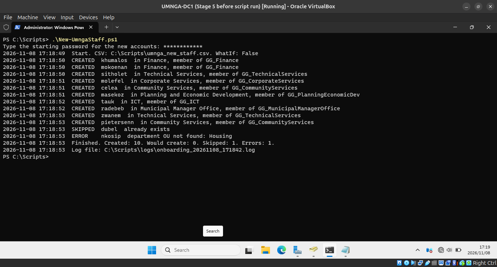

## Design decisions

1. One script file with a parameter for the CSV path and one for the log folder, so the same script can be pointed at a different list without editing it.
2. The script reads the list with `Import-Csv` and loops with `foreach`. Each CSV row becomes an object with named properties, so the script reads `$row.Department` and not a column number.
3. The CSV carries the department name and the group name for each person. The script does not guess. A row that names a department or group that does not exist is reported and not corrected.
4. There are three checks before every change: the department OU exists, the group exists, and the user does not already exist. A script that creates objects must first prove the target is there, and these checks make it safe to run twice.
5. The script skips a user who already exists and counts it as skipped, so it can be run again.
6. A bad row is reported as an ERROR and the script carries on with the next row. One bad row in a list of fifty should not stop the other forty nine, and the log shows which row failed and why.
7. The script supports the WhatIf switch with `[CmdletBinding(SupportsShouldProcess = $true)]` and the `ShouldProcess` method, so ICT can see what it would do before it does it. In preview mode it logs a WOULD CREATE line.
8. The script asks for the starting password with `Read-Host -AsSecureString` and keeps it in `$startPassword`. No password sits in the script, the CSV or the log, and the typed characters show as asterisks. The variable is not called `$pwd`, because that is a built in PowerShell variable.
9. There is one starting password for the whole run, with ChangePasswordAtLogon set. That is simple enough for a lab. A real environment would give each user a unique password.
10. Account creation and the group add sit inside try and catch with `-ErrorAction Stop`, so a failure is logged and counted and does not scroll past.
11. A `Write-Log` function prints each line and also appends it to a timestamped log file, with `-WhatIf:$false` on the file writes, so a preview run also leaves a record. The log file name carries the date and time, so no run overwrites an earlier one.
12. A summary line shows Created, Would create, Skipped and Errors, so the operator sees in one line whether the run did what they expected.
13. I took a snapshot before the script run, because the project changes the directory.
14. I tested the new accounts with the Effective Access tab again, because it needs no passwords and no client computer. It works out NTFS permissions only.

## Implementation

### 1. Read the directory first

On UMNGA-DC1 I checked that the ActiveDirectory module is available and listed the OUs, users and groups with `Get-Module`, `Get-ADOrganizationalUnit`, `Get-ADUser` and `Get-ADGroup`.

Observed: the module is version 1.0.1.0. Twelve OUs are listed: Community Services, Corporate Services, Departments, Domain Controllers, Finance, Groups, ICT, Municipal Manager Office, Planning and Economic Development, Servers, Technical Services and Umnga. Seven users are listed: ndlovut, dukan, naidooa, jacobsp, mabuzas, pillayz and dubel. Seven groups are listed, all with GroupScope Global.

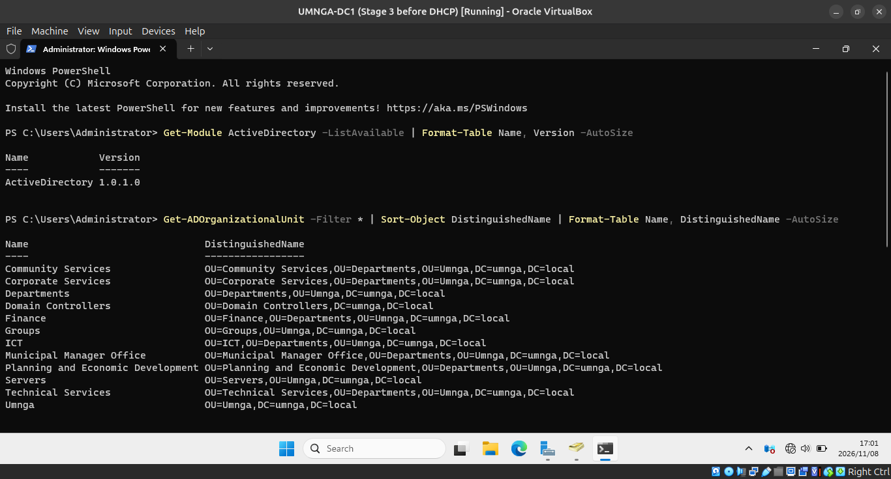

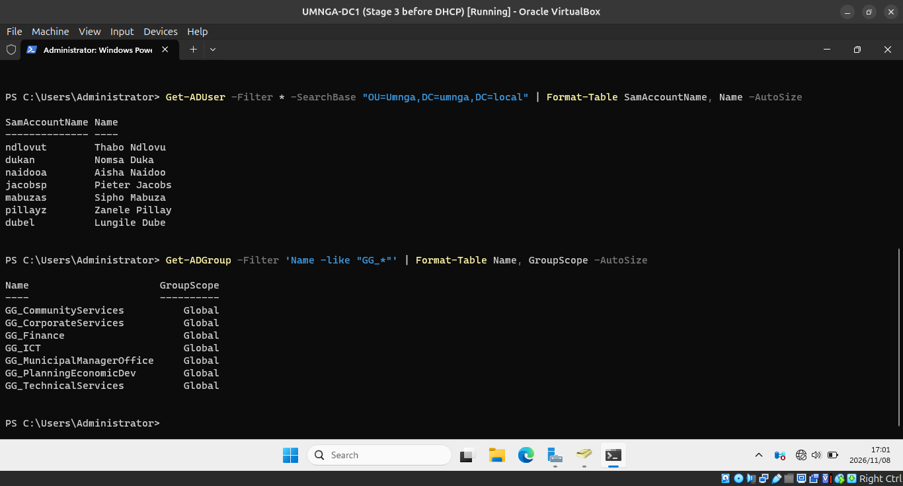

Evidence: 05_step01_ad_baseline_dc1.png, 05_step01_ad_baseline2_dc1.png

### 2. The list of new staff

Created C:\Scripts and saved a CSV there as umnga_new_staff.csv with twelve rows and the columns GivenName, Surname, SamAccountName, Department and Group. The sample is committed in [scripts](scripts/umnga_new_staff.csv). All names are invented. Two rows are tests on purpose: dubel (Lungile Dube) already exists from project 02, and nkosip (Pat Nkosi) names the department Housing and the group GG_Housing, neither of which exists.

Observed: `Import-Csv C:\Scripts\umnga_new_staff.csv | Format-Table -AutoSize` shows the twelve rows, and the count is 12.

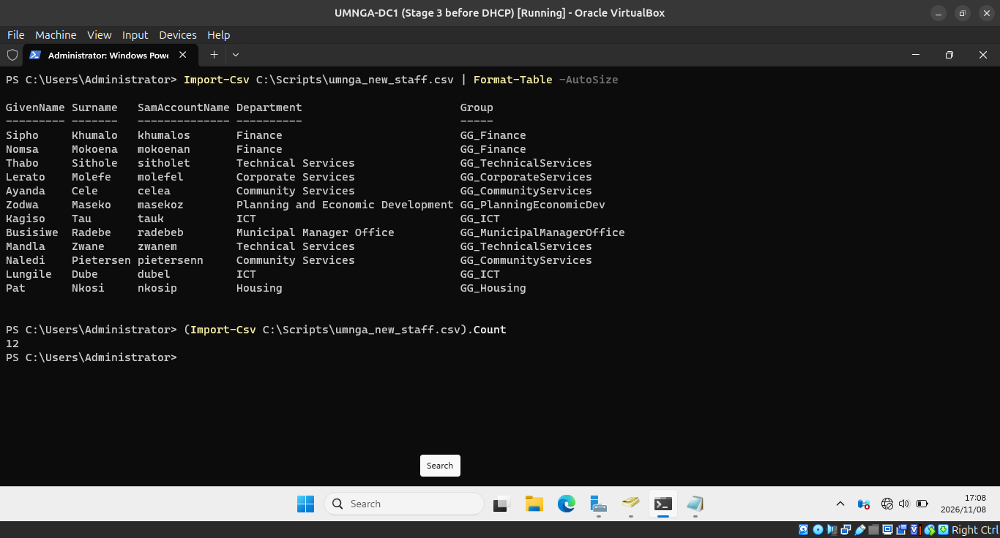

Evidence: 05_step02_csv_import_dc1.png

### 3. The script

Saved the script as C:\Scripts\New-UmngaStaff.ps1 (committed copy: [scripts/New-UmngaStaff.ps1](scripts/New-UmngaStaff.ps1)) and ran `Get-Command C:\Scripts\New-UmngaStaff.ps1 -Syntax`.

Observed: the syntax line shows the two optional parameters `[-CsvPath]` and `[-LogFolder]` and the switches `[-WhatIf]` and `[-Confirm]`, so PowerShell parsed the file and the WhatIf support is in place.

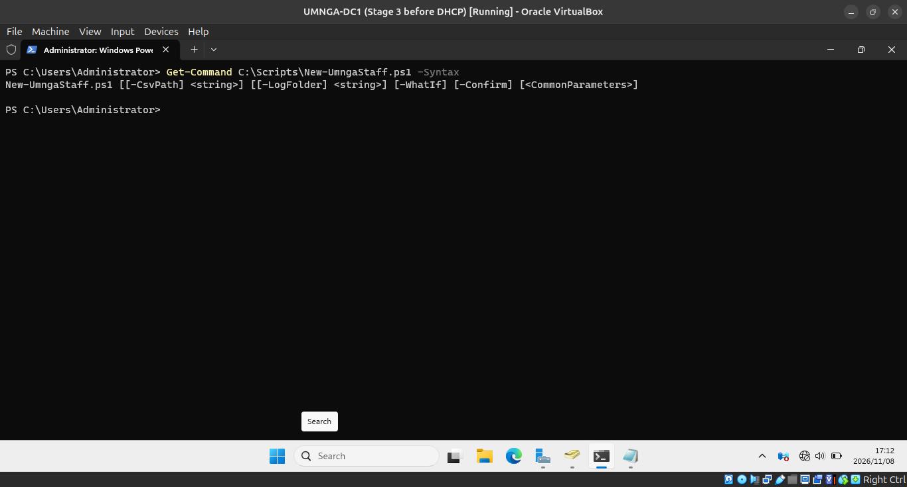

Evidence: 05_step03_script_syntax_dc1.png

### 4. Preview with WhatIf

Took a snapshot named "Stage 5 before script run", then ran `.\New-UmngaStaff.ps1 -WhatIf` from C:\Scripts and typed a starting password at the prompt.

Observed:

1. The Start line reads WhatIf: True. Ten rows print a PowerShell "What if: Performing the operation" line and then a WOULD CREATE line from the script.
2. dubel prints SKIPPED, already exists. nkosip prints ERROR, department OU not found: Housing.
3. The summary reads "Created: 0. Would create: 10. Skipped: 1. Errors: 1." The log file is onboarding_20261108_171500.log. A File Explorer tooltip covers the end of that file name in the screenshot, and it is readable in the later listing of the log folder.
4. The user count was still 7 afterwards. I recorded this from pasted output and not from a screenshot.

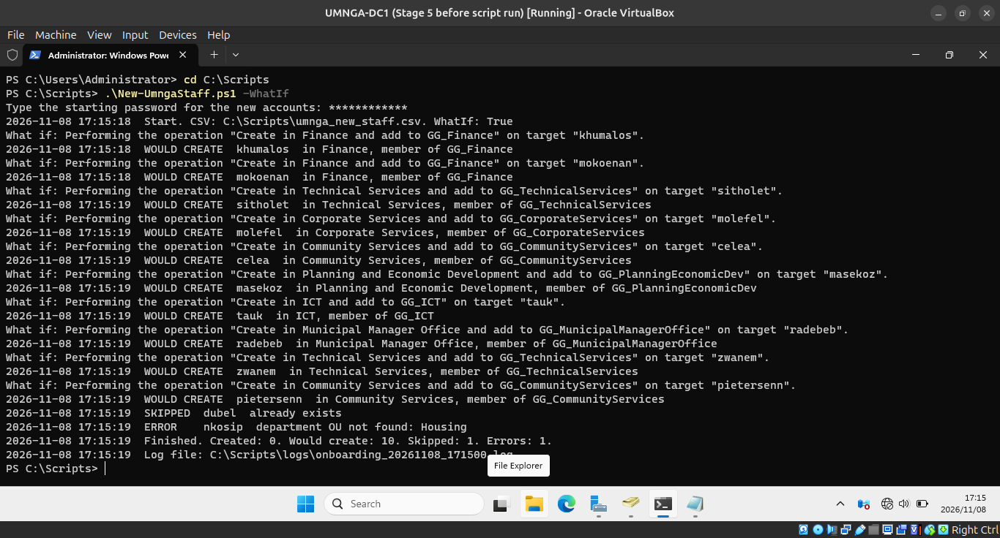

Evidence: 05_step04_whatif_run_dc1.png

### 5. The real run

Ran `.\New-UmngaStaff.ps1` without WhatIf, then read the directory with `Get-ADUser` on the Departments OU, `Get-ADGroupMember GG_Finance`, and `Get-ADUser` for khumalos with the PasswordLastSet property.

Observed:

1. The Start line reads WhatIf: False. Ten rows print CREATED, each with the department and the group. dubel prints SKIPPED and nkosip prints ERROR, department OU not found: Housing.
2. The summary reads "Created: 10. Would create: 0. Skipped: 1. Errors: 1." The log file is onboarding_20261108_171842.log.
3. The directory listing shows 17 users, all Enabled True, each new user in the OU of their department.
4. GG_Finance lists ndlovut, khumalos and mokoenan.
5. khumalos is Enabled True with an empty PasswordLastSet, which means the user has not set the password and must change it at first sign in.
6. Active Directory Users and Computers shows three users under Finance.

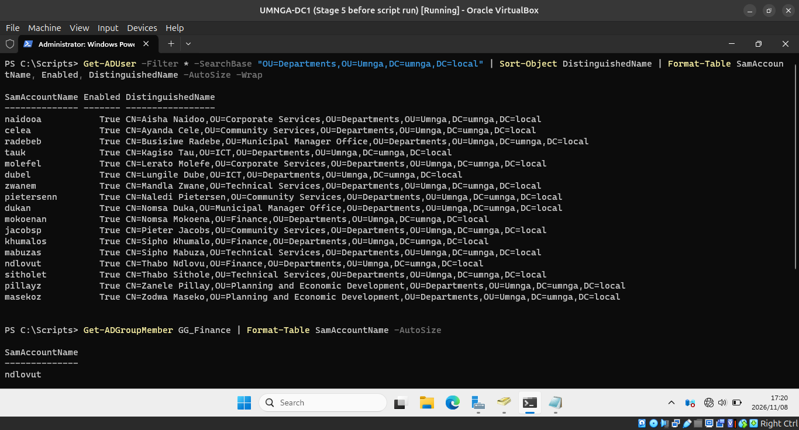

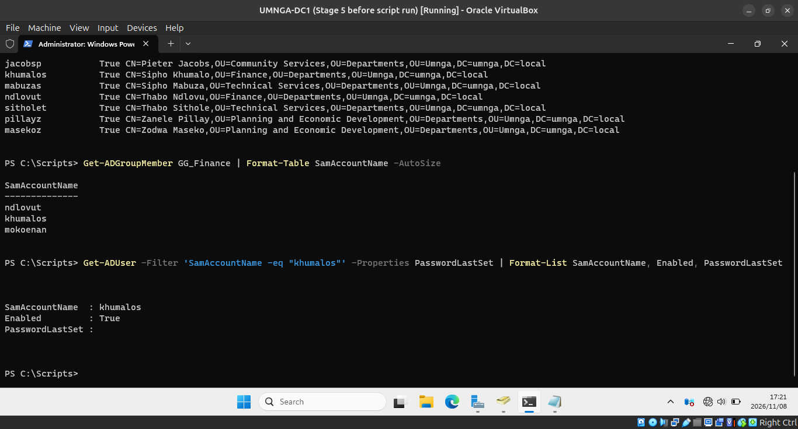

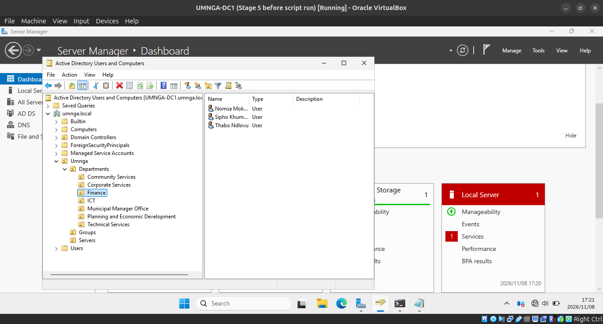

Evidence: 05_step05_real_run_dc1.png, 05_step05_users_in_ous_dc1.png, 05_step05_group_and_flag_dc1.png, 05_step05_aduc_finance_dc1.png

### 6. Run it a second time

Ran the script again, then counted the users and listed the log folder.

Observed:

1. Eleven rows print SKIPPED, already exists: the ten users created in step 5 and dubel. nkosip prints ERROR again.
2. The summary reads "Created: 0. Would create: 0. Skipped: 11. Errors: 1."
3. The user count is still 17.
4. The log folder holds three files: onboarding_20261108_171500.log (1315 bytes), onboarding_20261108_171842.log (1266 bytes) and onboarding_20261108_172354.log (919 bytes). Each run made its own log.

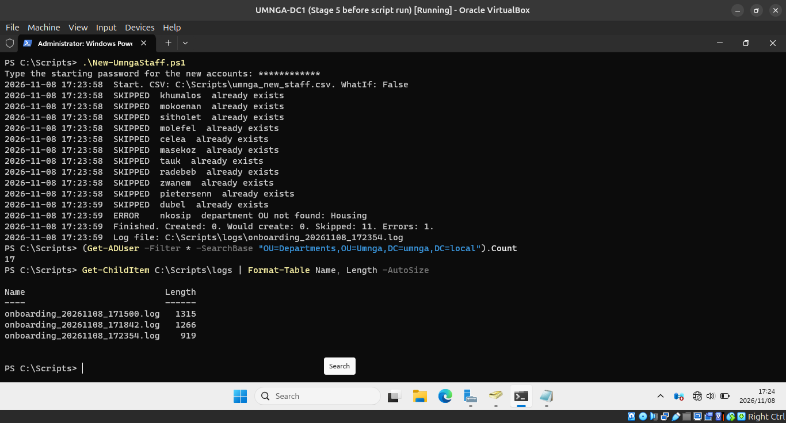

Evidence: 05_step06_second_run_dc1.png

### 7. Check access to the Finance folder

On UMNGA-SVR1 I opened the Effective Access tab of E:\Finance from project 04, selected khumalos, clicked View effective access, then did the same for sitholet.

Observed:

1. For Sipho Khumalo (khumalos@umnga.local) Full control is crossed out with Access limited by File Permissions, and the next four rows (Traverse folder, List folder, Read attributes and Read extended attributes) are ticked. The sixth row, Create files, is cut off at the bottom edge of the window with a tick partly visible. The remaining rows are not in the screenshot.
2. For Thabo Sithole (sitholet@umnga.local) every visible row is crossed out with Access limited by File Permissions.

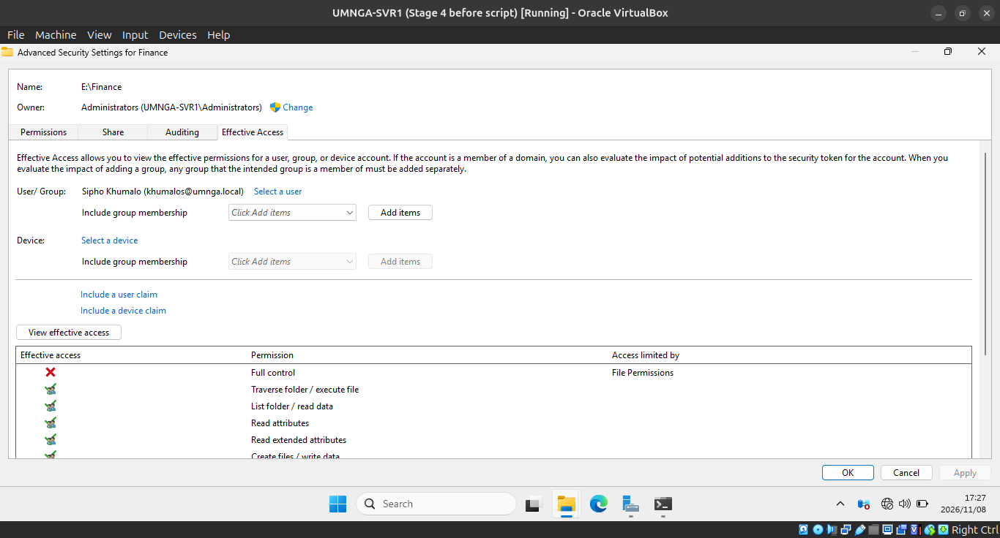

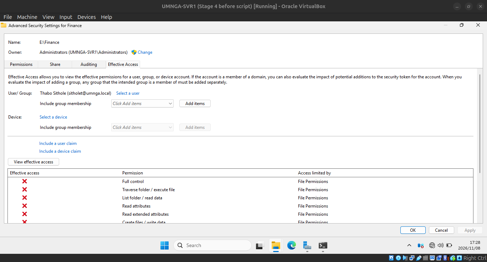

Evidence: 05_step07_effective_access_new_finance_svr1.png, 05_step07_effective_access_new_other_svr1.png

## Verification

1. The ActiveDirectory module is available, and the directory held 12 OUs, 7 users and 7 GG_ groups before the script.
2. The CSV has 12 rows and `Import-Csv` reads it.
3. The script parses and supports WhatIf and Confirm.
4. The preview run reported 10 would create, 1 skipped and 1 error, and changed nothing.
5. The real run created 10 users, skipped 1 and reported 1 error. The directory then held 17 users, each new user in the right OU and the right group.
6. The second run created nothing, skipped 11 and reported the same error.
7. Three timestamped logs exist, one for each run.
8. The effective access check on E:\Finance showed khumalos with the first rows of Modify level access and sitholet with none.

## Limitations

1. No new user signed in. I inferred the forced password change at first sign in from the empty PasswordLastSet of one account and did not test it.
2. I did not record the starting password anywhere, on purpose, and I did not check its strength.
3. I did not show the contents of the log files, only the lines printed on screen and the file sizes.
4. The effective access screenshot for khumalos shows only six rows, so the Modify level is not visible in full. The check calculates NTFS permissions only.
5. I read PasswordLastSet for one new account. I did not read the other nine.
6. I did not test the script with a CSV that has a missing column, an empty row, a name with an apostrophe, or a SamAccountName longer than 20 characters.
7. The script only creates accounts. There is no leaver, move or update process.

## Files

1. [scripts/New-UmngaStaff.ps1](scripts/New-UmngaStaff.ps1) and [scripts/umnga_new_staff.csv](scripts/umnga_new_staff.csv)
2. [scripts/README.md](scripts/README.md)
3. [Captions](evidence/Captions.md)
4. [Troubleshooting log](Troubleshooting%20log.md)
5. [Naming and IP standard](../docs/Naming%20and%20IP%20standard.md)
