# 07 Access review: security groups, account lockout and who holds power

Status: complete (14 November 2026)
Deliverable: [Umnga Access Review](Access%20review.md)
Builds on: [05 Onboarding automation](../05%20Onboarding%20automation), [02 Identity and policy](../02%20Identity%20and%20policy)

## Scenario

Two things keep landing on ICT. Staff get locked out of their accounts, and the municipal auditor has asked who holds powerful rights on the servers. At the start of this project the honest answer to the second question was "the Administrator, and nobody else knows", because every admin job in the lab was done as one shared account. The domain also never locked an account, however many wrong passwords were tried. I did four things on UMNGA-DC1, UMNGA-SVR1 and UMNGA-CORE1: built role based groups, set a lockout policy and reproduced a lockout on an invented account, gave the helpdesk the right to unlock accounts and nothing more, and read out who holds admin rights and sign in rights on all three machines.

## Objectives

1. Record who holds power in the domain, and what the lockout policy is, before changing anything.
2. Build role based security groups in the pattern accounts, global groups, domain local group, permission.
3. Set an account lockout policy, lock out an invented account on purpose and trace the lockout to the computer that caused it.
4. Give a helpdesk group the right to unlock accounts and reset passwords on the department OUs, and show it cannot make itself an administrator.
5. Report who is in the privileged groups and in the local Administrators group of each server.
6. Give a server admin group local administrator rights on the member servers with Group Policy, and prove it with a before and after test.
7. Read the user rights that control who may sign in, back up files and take ownership on each machine.
8. Show that changes to group membership are recorded, and by whom.

## State at the end of the project

1. The Default Domain Policy locks an account after 5 invalid logon attempts, for 15 minutes, and resets the counter after 15 minutes. A fourth setting, Allow Administrator account lockout, appeared as Enabled when I set the threshold.
2. The OU Groups holds three new groups beside the seven department groups: GG_ICT_Helpdesk and GG_ICT_ServerAdmins (global, security) and DL_Servers_LocalAdmins (domain local, security). tauk is in GG_ICT_Helpdesk and dubel is in GG_ICT_ServerAdmins. GG_ICT_ServerAdmins is the only member of DL_Servers_LocalAdmins.
3. GG_ICT_Helpdesk can reset passwords and read and write lockoutTime on user objects in OU Departments. As tauk, I unlocked a locked account, and an attempt to add tauk to Domain Admins failed.
4. A new GPO, Umnga Servers Local Admins, is linked to OU Servers. It adds DL_Servers_LocalAdmins to the local Administrators group on UMNGA-SVR1 and UMNGA-CORE1 and leaves the existing members alone. Before it applied, dubel was refused a remote command on SVR1 with Access is denied. After it applied, dubel ran commands on both servers.
5. Domain Admins, Enterprise Admins and Schema Admins each have one member, the Administrator. Account Operators, Server Operators and Backup Operators have none. The local Administrators group of each server holds UMNGA\Domain Admins and that server's own local Administrator.
6. On the member servers, the group Users may sign in locally, and on SVR1 Authenticated Users holds the Remote Desktop sign in right. These are the Windows defaults and I did not change them.
7. The domain controller audits Security Group Management, User Account Management and Computer Account Management for success. Adding and removing a test account from GG_ICT_Helpdesk produced events 4728 and 4729, both by Administrator.
8. The test account lockoutt (Test Lockout, in OU ICT) and the role users tauk and dubel are still in the domain. I reset the passwords of tauk and dubel by hand during the project.

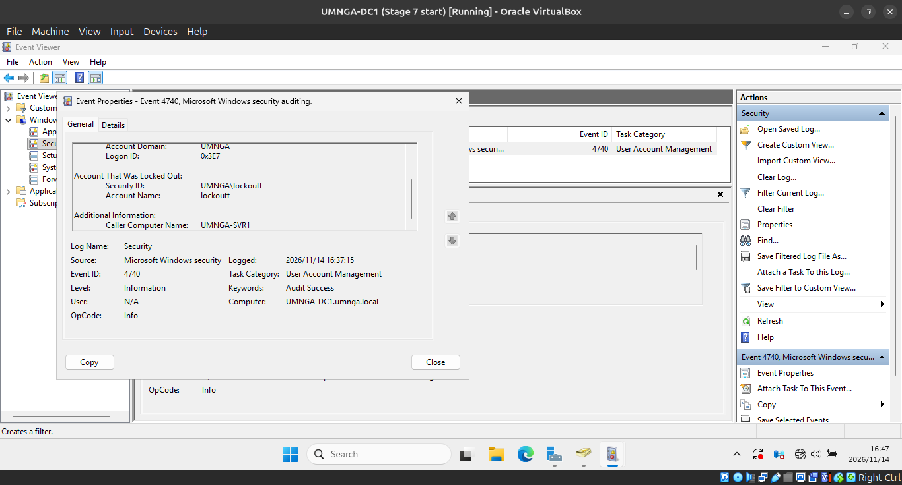

## Design decisions

1. The pattern is accounts into global groups, global groups into a domain local group, and permissions to the domain local group. The department groups from project 02 already did the global half. DL_Servers_LocalAdmins shows the second half, so a person who changes job moves between global groups and no permission list changes.
2. The lockout policy is 5 attempts, 15 minutes locked and 15 minutes to reset the counter. Five is strict enough to stop guessing, and fifteen minutes is short enough that a clerk who mistypes on Monday morning loses a coffee break. The cost is that anyone can lock a colleague out on purpose, so the helpdesk needs a quick way to unlock.
3. I set the policy in the Default Domain Policy, because domain account policies only apply from a GPO linked at the top of the domain, and that is where the course puts them. This goes against my own naming standard, which says not to edit the Default Domain Policy. The standard now records the exception. A cleaner design would be a separate GPO linked to the domain with a higher link order, and I did not build that.
4. I tested the lockout on an invented account in an ICT OU, from UMNGA-SVR1, with the IP address of the domain controller. Using the address meant Windows did not reuse my existing session as Administrator. I never test on the built in Administrator, because it is the only admin account in the domain.
5. The helpdesk right is two delegations on OU Departments: reset user passwords, and read and write lockoutTime on user objects. Unlocking an account changes lockoutTime, so that property is all the group needs. Nothing gives it write access to group membership, which is why the attempt to add tauk to Domain Admins failed.
6. For local administrators on the servers I used a Group Policy Preferences local group item with the action Update, not Restricted Groups. Restricted Groups replaces the whole membership, so one mistake could remove the local Administrator and Domain Admins and lock everyone out. Update only adds one entry.
7. The access review reads state and changes little. Apart from the group, delegation and GPO above, I changed nothing about who may sign in or which rights anyone holds.
8. I proved each change with a before and after test, and the lockout policy with the sixth attempt being refused as locked. A setting that has only been seen in a dialog has not been shown to work.

## Implementation

### 1. Baseline

On UMNGA-DC1 I took a snapshot named "Stage 7 start" (also on UMNGA-SVR1), then opened the members of Domain Admins and the Builtin Administrators group in Active Directory Users and Computers, and the settings of the Default Domain Policy in Group Policy Management.

Observed:

1. Domain Admins has one member, Administrator (umnga.local/Users).
2. The Builtin Administrators group holds Administrator, Domain Admins and Enterprise Admins.
3. The Account Lockout Policy section of the Default Domain Policy lists only "Account lockout threshold: 0 invalid logon attempts". Zero means an account is never locked.

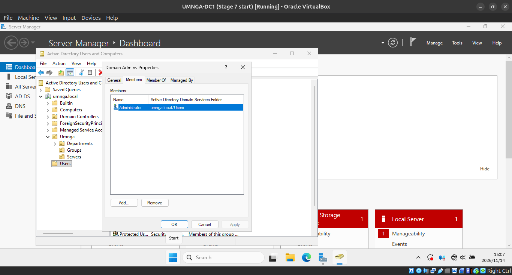

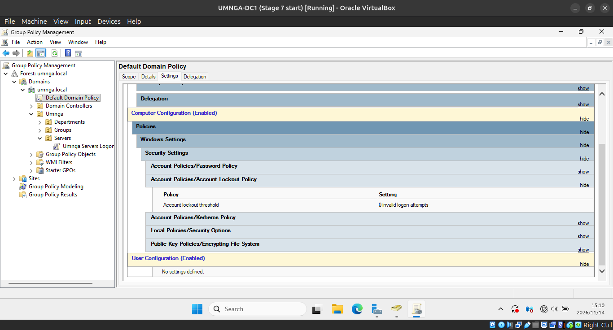

Evidence: 07_step01_domain_admins_dc1.png, 07_step01_builtin_administrators_dc1.png, 07_step01_lockout_policy_before_dc1.png

### 2. Role based security groups

In Active Directory Users and Computers I created GG_ICT_Helpdesk and GG_ICT_ServerAdmins in OU Groups as global security groups, and DL_Servers_LocalAdmins as a domain local security group. I added tauk to the first group, dubel to the second, and GG_ICT_ServerAdmins to the domain local group. Then I read the result with PowerShell.

Observed:

1. The Groups OU lists ten groups. The seven department groups and the two new role groups are Security Group Global, and DL_Servers_L... is Security Group Domain Local. The Description column is empty.
2. The Members tab of DL_Servers_LocalAdmins holds one entry, a group from umnga.local/Umnga/Groups starting GG_ICT_Serv.
3. Get-ADGroup lists GG_ICT_Helpdesk and GG_ICT_ServerAdmins as Global and DL_Servers_LocalAdmins as DomainLocal, all Security. The Description column is blank in that output, because the command did not ask for the Description property. I did not read the descriptions back.
4. Get-ADGroupMember shows Kagiso Tau (tauk) in GG_ICT_Helpdesk and Lungile Dube (dubel) in GG_ICT_ServerAdmins. DL_Servers_LocalAdmins holds one group, GG_ICT_ServerAdmins, and the recursive list reaches Lungile Dube (dubel) only.

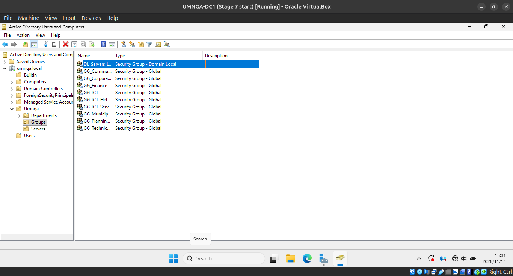

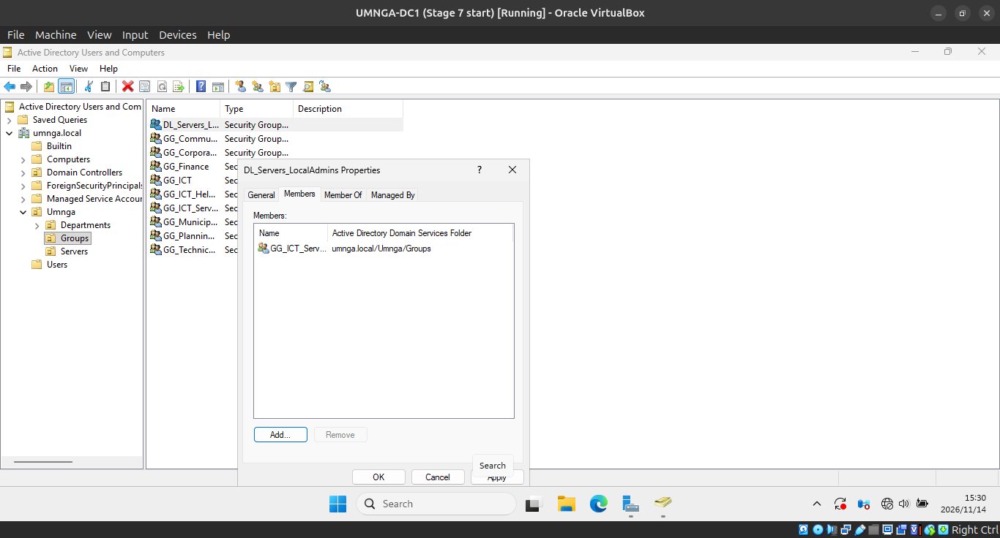

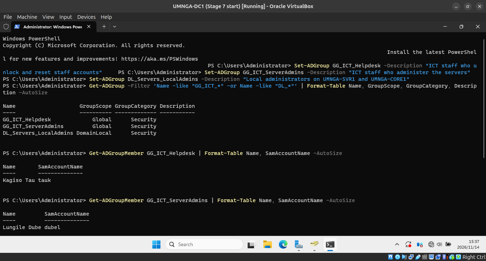

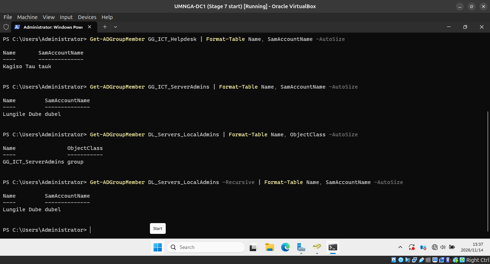

Evidence: 07_step02_groups_ou_dc1.png, 07_step02_dl_servers_localadmins_members_dc1.png, 07_step02_group_membership_powershell_dc1.png, 07_step02_group_membership2_powershell_dc1.png

### 3. The lockout policy

In the Default Domain Policy I went to Computer Configuration, Policies, Windows Settings, Security Settings, Account Policies, Account Lockout Policy, set the threshold to 5, and set the duration and the reset counter to 15 minutes. Then I ran gpupdate /force and read the policy with PowerShell.

Observed:

1. The editor lists four settings: Account lockout duration 15 minutes, Account lockout threshold 5 invalid logon attempts, Allow Administrator account lockout Enabled, and Reset account lockout counter after 15 minutes. I did not set the third one. It appeared when I defined the threshold.
2. gpupdate /force at 16:08 reported that computer policy and user policy completed successfully. Get-ADDefaultDomainPasswordPolicy shows LockoutThreshold 5, LockoutDuration 00:15:00 and LockoutObservationWindow 00:15:00.

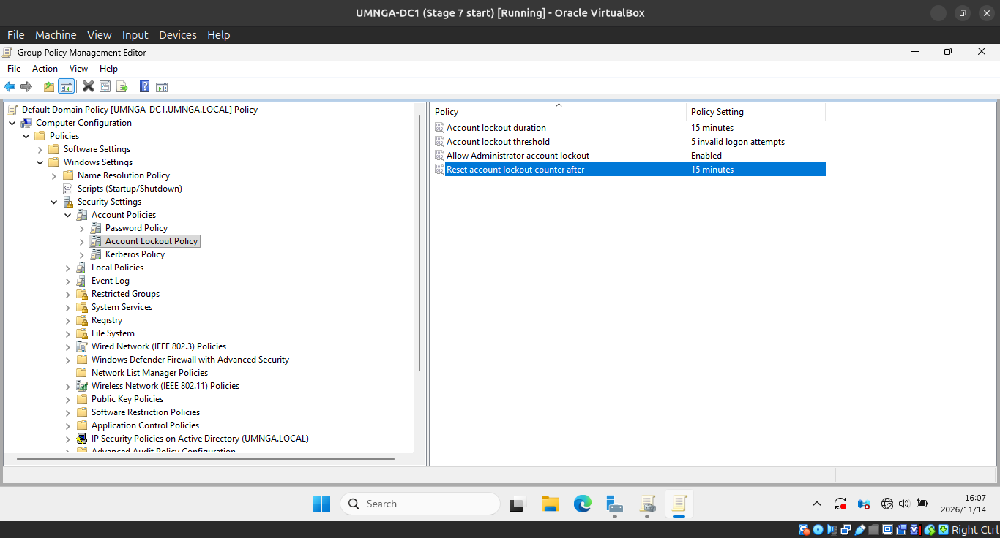

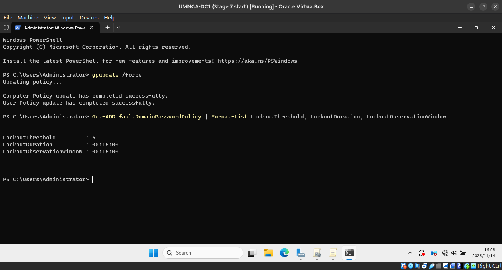

Evidence: 07_step03_lockout_policy_set_dc1.png, 07_step03_lockout_policy_powershell_dc1.png

### 4. Cause a lockout and trace it

I created the invented user Test Lockout (logon name lockoutt) in OU ICT. From UMNGA-SVR1 I sent six wrong passwords to the domain controller's address with net use. Then I read the lockout on the domain controller, waited for it to expire, and finally proved that the right password worked.

The first attempt did not lock anything. The account's logon name had been saved as locoutt, one letter short, so every wrong password was sent to a user that does not exist. See the [Troubleshooting log](Troubleshooting%20log.md). I renamed the logon name with Set-ADUser and repeated the test.

Observed:

1. The six attempts at 16:37 return system error 1326 (the user name or password is incorrect) five times, and system error 1909 (the referenced account is currently locked out) the sixth time.
2. At 16:38 the Account tab of Test Lockout reads "Unlock account. This account is currently locked out on this Active Directory Domain Controller", with the box unticked.
3. Event 4740 was logged on UMNGA-DC1.umnga.local at 2026/11/14 16:37:15. Account That Was Locked Out is UMNGA\lockoutt, and Caller Computer Name is UMNGA-SVR1.
4. At 16:49 Search-ADAccount -LockedOut lists Test Lockout as locked, and a Get-WinEvent query for 4740 returns one row: 16:37:15, lockoutt, UMNGA-SVR1. A separate check showed BadLogonCount 5.
5. At 16:53 Search-ADAccount -LockedOut returns nothing, and Get-ADUser shows LockedOut False and BadLogonCount 5. The lock ran out by itself at about 16:52, so this picture shows the 15 minute duration working. It does not show the Unlock account box working. Step 5 does that.
6. At 16:54 net use with the real password, typed at a hidden prompt, reports "The command completed successfully". I ran this one on UMNGA-DC1, and not on UMNGA-SVR1 as planned.

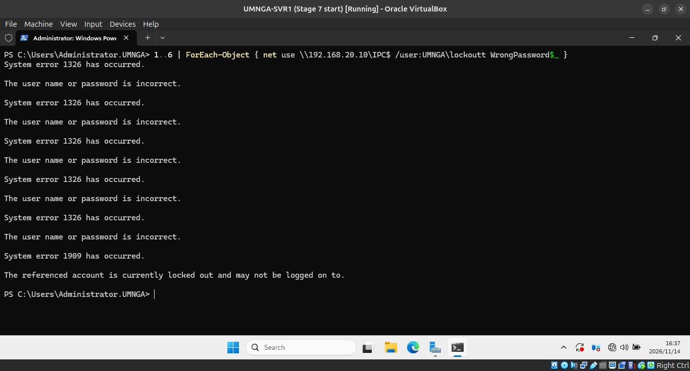

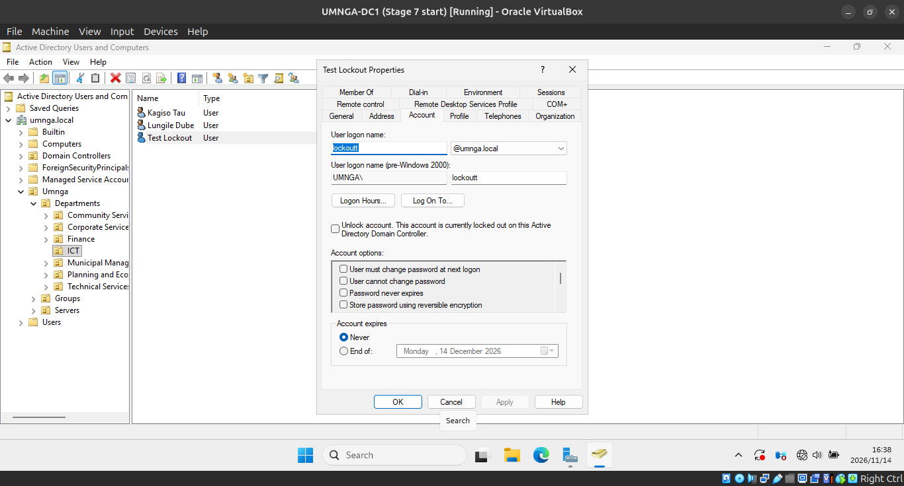

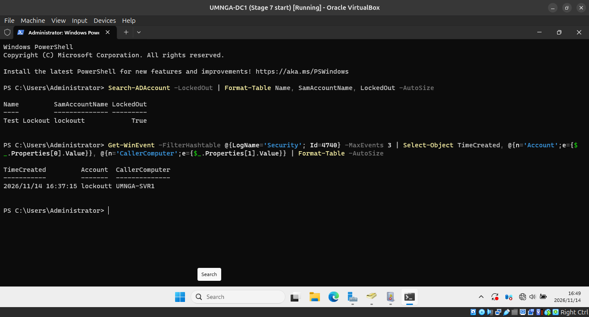

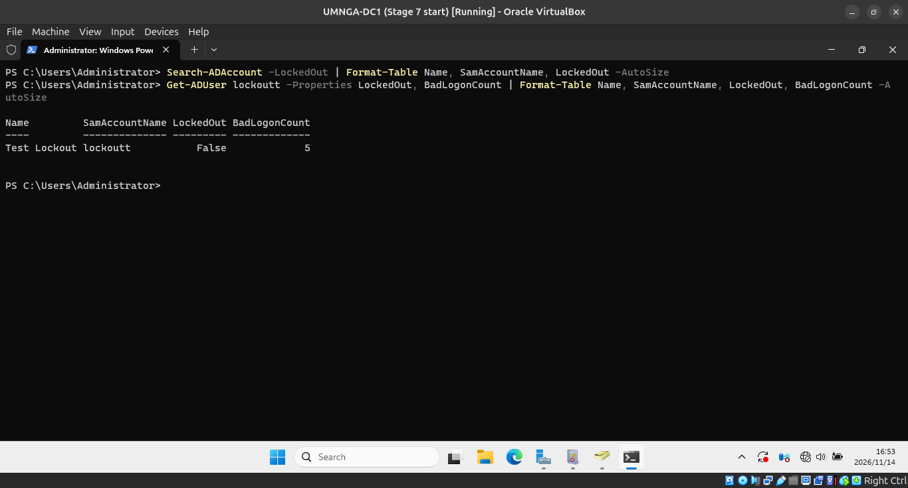

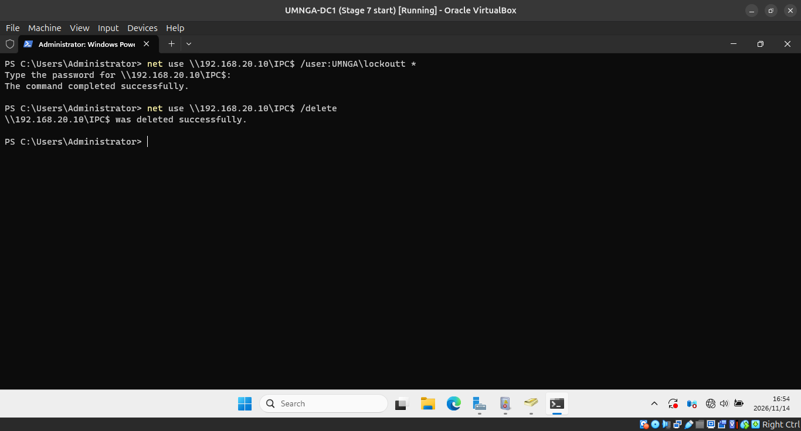

Evidence: 07_step04_wrong_attempts_svr1.png, 07_step04_locked_out_dc1.png, 07_step04_event_4740_dc1.png, 07_step04_lockout_powershell_dc1.png, 07_step04_unlocked_dc1.png, 07_step04_correct_password_dc1.png

### 5. Give the helpdesk the right to unlock

I ran the Delegation of Control wizard twice on OU Departments for GG_ICT_Helpdesk. The first run delegated "Reset user passwords and force password change at next logon". The second was a custom task for user objects, with Read lockoutTime and Write lockoutTime. Then I locked lockoutt again from SVR1 and tested as tauk.

The first tests failed with "Either the target name is incorrect or the server has rejected the client credentials", and the cause turned out to be tauk's account and not the delegation. See the [Troubleshooting log](Troubleshooting%20log.md). I reset tauk's password and cleared the forced change, then tried again with Get-Credential for UMNGA\tauk.

Observed:

1. The wizard's Permissions page shows Property specific and General ticked, with Read lockoutTime and Write lockoutTime ticked in the list.
2. As tauk, at 17:10, Search-ADAccount -LockedOut lists lockoutt as locked. Unlock-ADAccount lockoutt prints nothing. A second search prints nothing.
3. As tauk, Add-ADGroupMember "Domain Admins" -Members tauk fails with "Insufficient access rights to perform the operation" (ADException, server error 8344). Get-ADGroupMember "Domain Admins" still lists only Administrator.

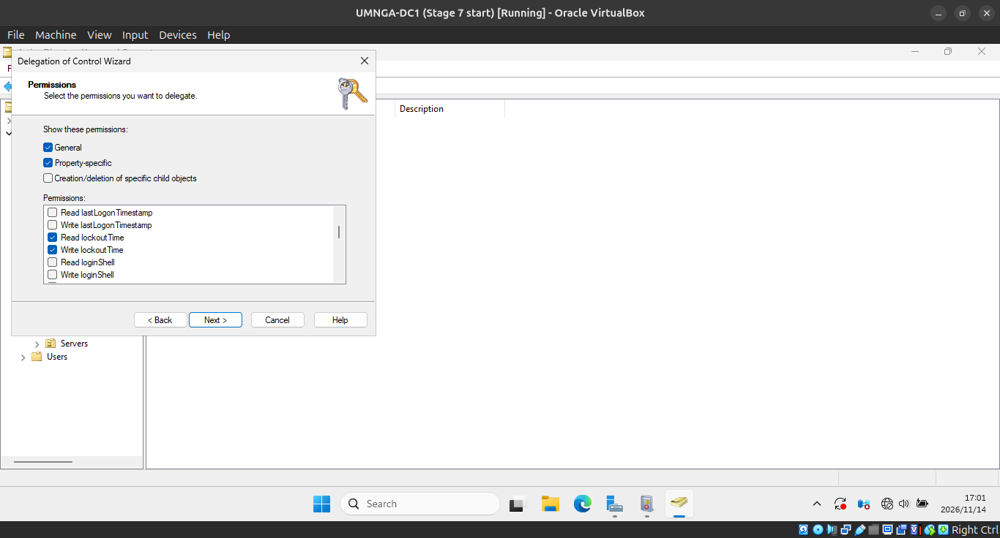

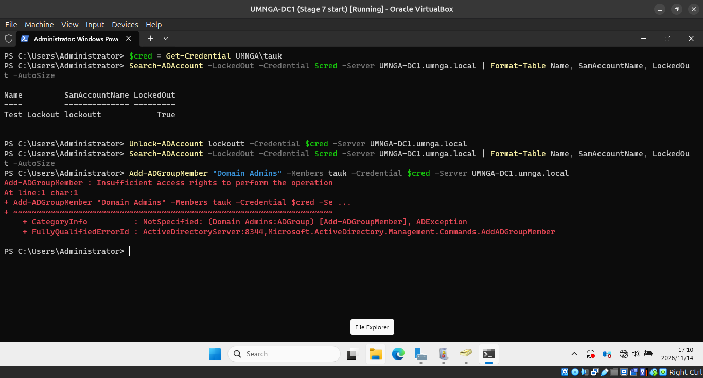

Evidence: 07_step05_delegation_wizard_dc1.png, 07_step05_helpdesk_unlock_dc1.png

### 6. Who holds power: the group report

On UMNGA-DC1 I counted the members of seven powerful groups with nested groups expanded, and asked both member servers for their local Administrators group with Invoke-Command. On UMNGA-SVR1 I also opened the group in Computer Management.

Observed:

1. At 17:12 Domain Admins, Enterprise Admins, Schema Admins and Administrators each show 1 member, Administrator. Account Operators, Server Operators and Backup Operators show 0.
2. Computer Management on UMNGA-SVR1 at 17:17 lists Administrator and UMNGA\Domain Admins in the local Administrators group.
3. The first Invoke-Command at 17:14 returned the two entries for UMNGA-SVR1 and a WinRM timeout error for UMNGA-CORE1. At 17:23 Test-NetConnection to port 5985 succeeded for both servers, and Invoke-Command returned both. UMNGA-SVR1 holds UMNGA\Domain Admins (Group) and UMNGA-SVR1\Administrator (User). UMNGA-CORE1 holds UMNGA\Domain Admins (Group) and UMNGA-CORE1\Administrator (User).

The Administrator on each server is a local account of that server. It is not the domain Administrator.

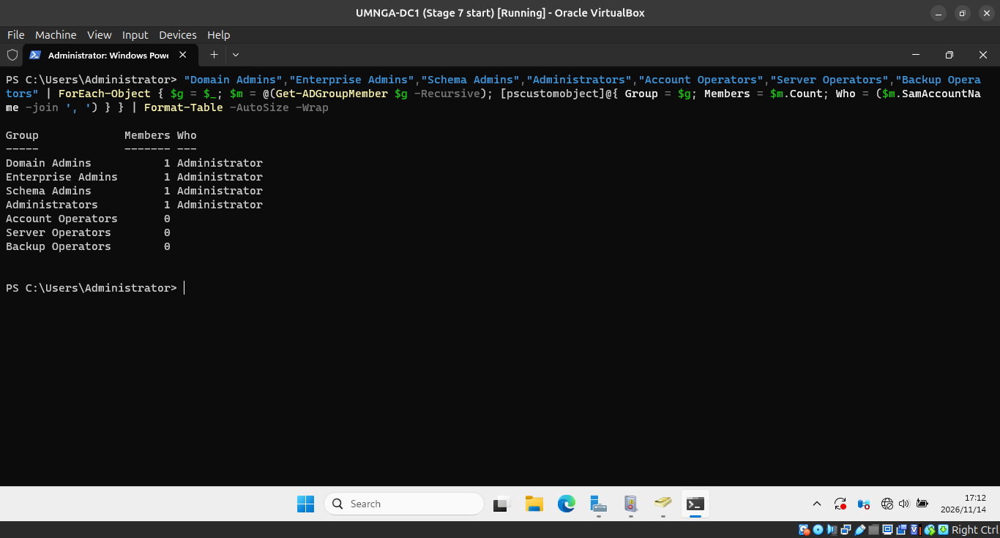

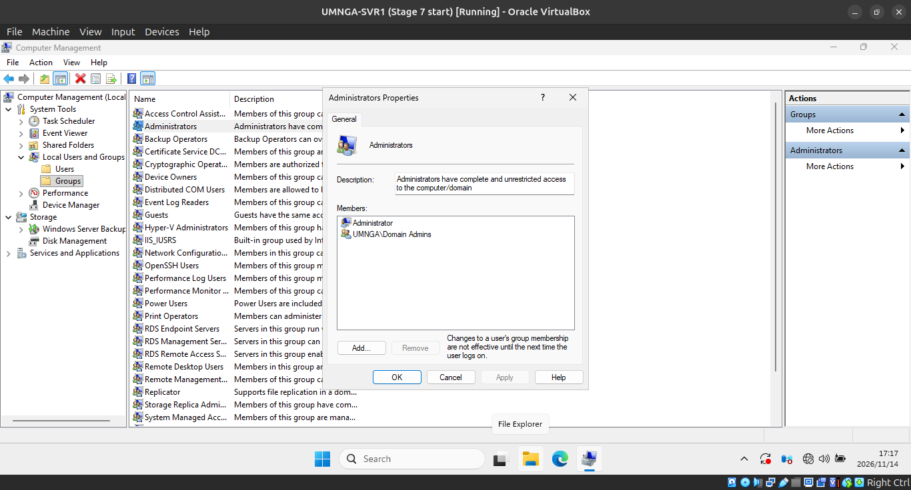

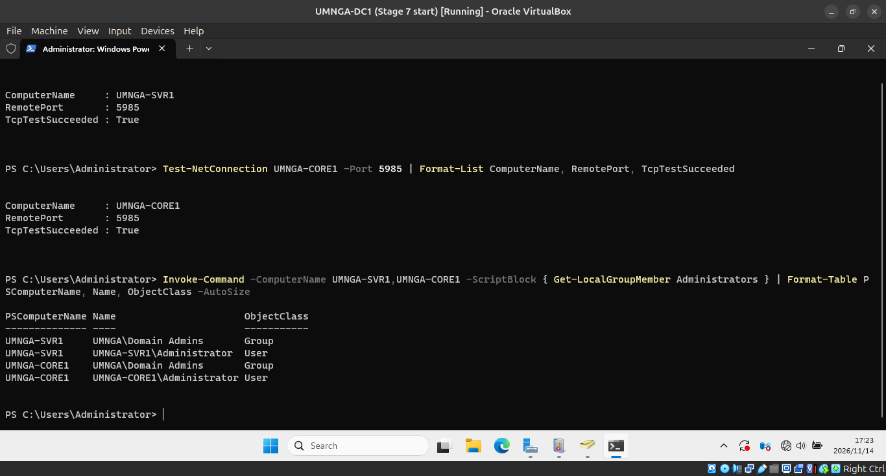

Evidence: 07_step06_privileged_groups_dc1.png, 07_step06_local_admins_gui_svr1.png, 07_step06_local_administrators_dc1.png

### 7. Local administrators by Group Policy

I reset dubel's password and tested a remote command as dubel against UMNGA-SVR1. Then I created the GPO Umnga Servers Local Admins and linked it to OU Servers. In its Computer Configuration, Preferences, Control Panel Settings, Local Users and Groups, I added a Local Group item with Action Update, Group name Administrators (built-in), and the member UMNGA\DL_Servers_LocalAdmins set to Add to this group. I refreshed policy on both servers and repeated the test.

Observed:

1. At 17:26, before the policy, Invoke-Command as dubel fails with "Connecting to remote server UMNGA-SVR1 failed with the following error message : Access is denied", error id AccessDenied.
2. The Local Group dialog at 17:33 shows Action Update, Group name Administrators (built-in), and the member UMNGA\DL_Servers_LocalAdmins with Action Add to this group.
3. At 17:36, after gpupdate /force on both servers, Get-LocalGroupMember Administrators lists three entries on each: UMNGA\DL_Servers_LocalAdmins, UMNGA\Domain Admins and the server's local Administrator.
4. At 17:37 Invoke-Command as dubel returns umnga\dubel and UMNGA-SVR1, then umnga\dubel and UMNGA-CORE1.

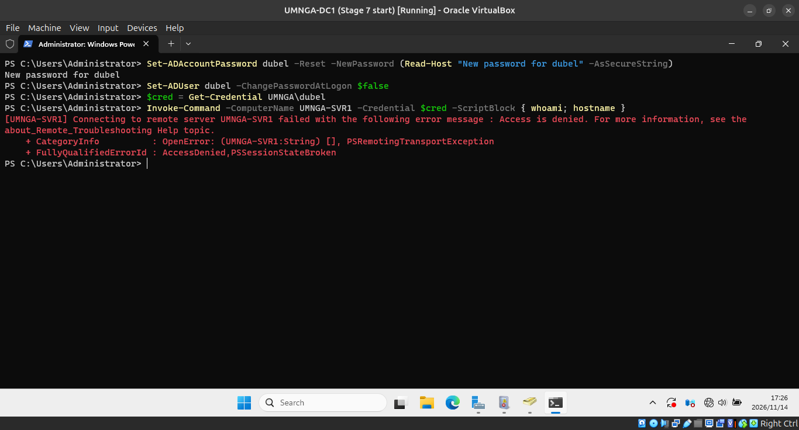

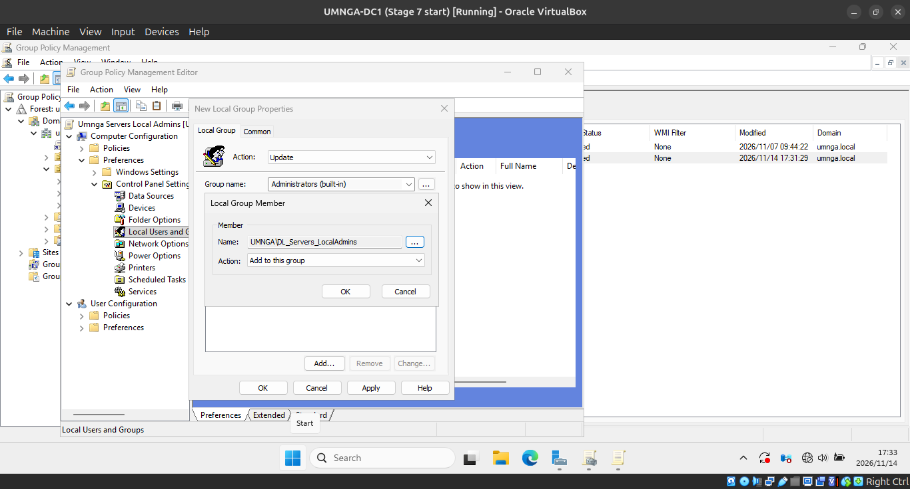

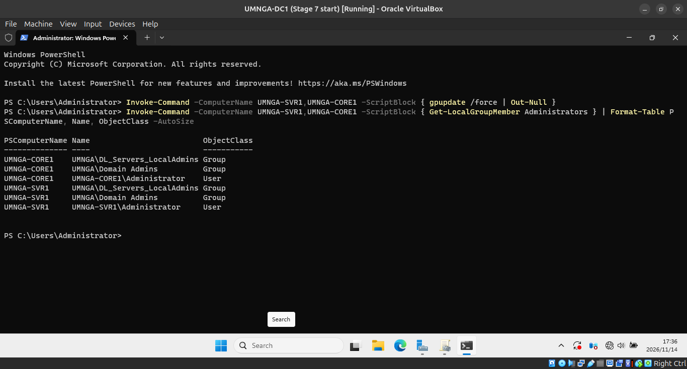

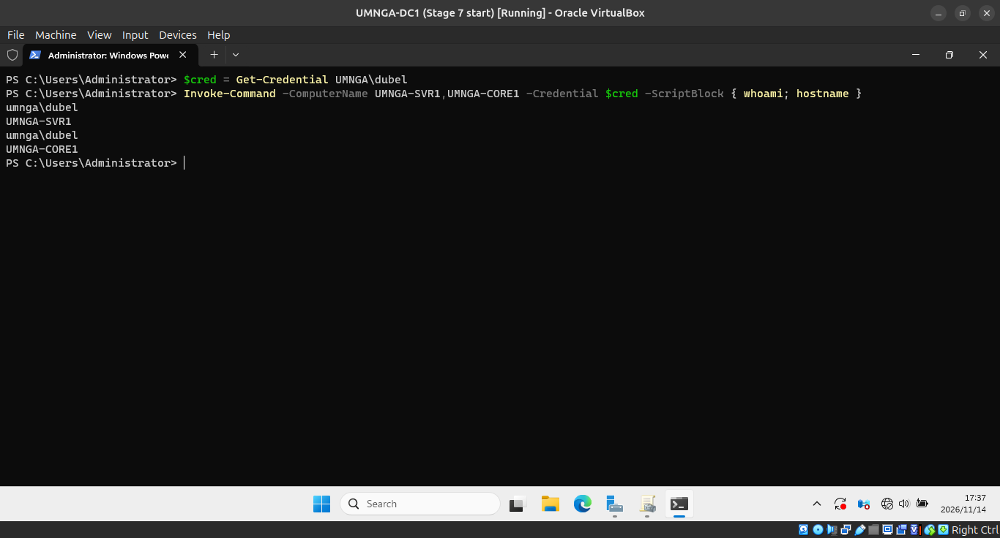

Evidence: 07_step07_dubel_before_dc1.png, 07_step07_gpo_local_group_dc1.png, 07_step07_local_administrators_after_dc1.png, 07_step07_dubel_after_dc1.png

### 8. User rights

On UMNGA-SVR1 I opened Local Security Policy, Local Policies, User Rights Assignment, and read Allow log on locally. Then I exported the user rights of all three machines with secedit through Invoke-Command, translated the SIDs into names, and printed the rights an auditor asks about.

Observed:

1. Allow log on locally on UMNGA-SVR1 lists Administrators, Backup Operators and Users.
2. Log on locally (SeInteractiveLogonRight) is Administrators, Users and Backup Operators on UMNGA-SVR1 and UMNGA-CORE1. On UMNGA-DC1 it is Administrators, Account Operators, Server Operators, Print Operators, Backup Operators and the domain controllers group.
3. Log on through Remote Desktop Services (SeRemoteInteractiveLogonRight) is Administrators and Remote Desktop Users on CORE1, Administrators only on DC1, and Authenticated Users, Administrators and Remote Desktop Users on SVR1.
4. Back up files and Restore files are Administrators and Backup Operators on the servers, with Server Operators added on DC1. Debug programs and Take ownership are Administrators only on all three machines. Shut down the system is Administrators and Backup Operators on the servers, with Server Operators and Print Operators added on DC1.
5. No department group, role group or named person appears in any of these rights.

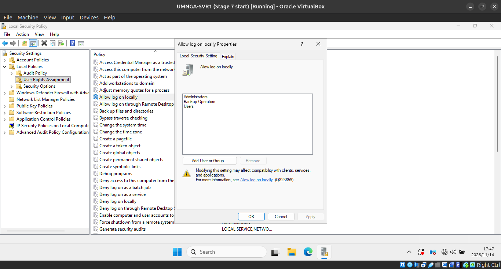

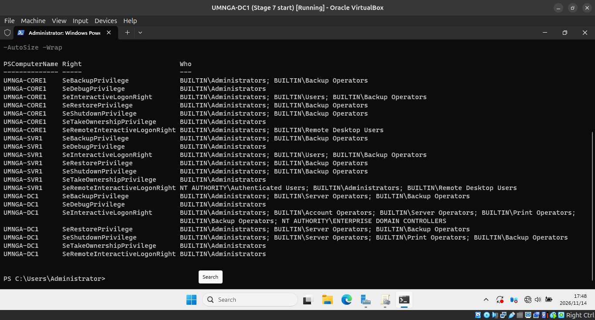

Evidence: 07_step08_user_rights_gui_svr1.png, 07_step08_user_rights_dc1.png

### 9. Who changed the groups

On UMNGA-DC1 I read the Account Management audit settings with auditpol. Then I added lockoutt to GG_ICT_Helpdesk and removed it again in Active Directory Users and Computers, and read the events with Get-WinEvent.

Observed:

1. At 17:51 Security Group Management, User Account Management and Computer Account Management are set to Success. Distribution Group Management, Application Group Management and Other Account Management Events read No Auditing.
2. At 17:54 the query for events 4728 and 4729 returns four rows. 17:53:49 is a 4729 for Test Lockout and GG_ICT_Helpdesk. 17:53:39 is a 4728 for the same two. 15:30:03 is a 4728 for Lungile Dube and GG_ICT_ServerAdmins, and 15:29:44 is a 4728 for Kagiso Tau and GG_ICT_Helpdesk. The ChangedBy column reads Administrator on all four.

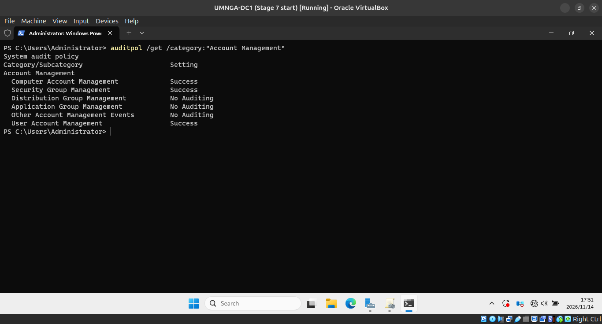

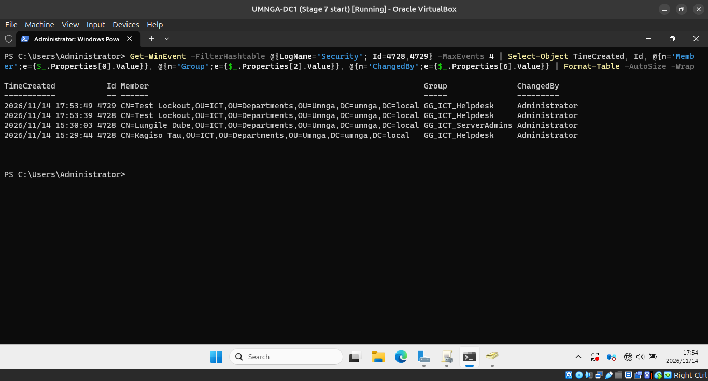

Evidence: 07_step09_audit_policy_dc1.png, 07_step09_group_change_events_dc1.png

## Verification

1. Get-ADDefaultDomainPasswordPolicy reads threshold 5, duration 15 minutes and window 15 minutes, and the sixth wrong password was refused with error 1909.
2. Event 4740 on UMNGA-DC1 names the locked account (lockoutt) and the computer it came from (UMNGA-SVR1).
3. A helpdesk account unlocked a locked account, and the same account was refused when it tried to add itself to Domain Admins. Domain Admins still lists only Administrator.
4. dubel was refused on UMNGA-SVR1 before the policy and ran commands on both servers after it. The nesting from account to global group to domain local group to local Administrators is shown end to end.
5. The privileged group counts, the local Administrators of both servers and the user rights of all three machines were read and are on screen.
6. Events 4728 and 4729 show a group change and its reversal, with the account that made them.

## Limitations

1. The lockout policy lives in the Default Domain Policy, which my naming standard says not to edit. I did not build a separate GPO with a higher link order.
2. Allow Administrator account lockout is Enabled. I did not test it. In this lab the Administrator is the only admin account, so five wrong passwords against it would lock the whole domain out of admin work for 15 minutes.
3. The Unlock account box in Active Directory Users and Computers was never shown to work. In step 4 the lock expired by itself, and in step 5 I unlocked with PowerShell as tauk. I did not unlock lockoutt with the box.
4. The delegation covers OU Departments, and dubel's account sits in OU ICT, under Departments. The right to reset passwords on that OU therefore reaches dubel, and an account that can reset dubel's password could sign in as dubel and gain administrator rights on both servers. I did not test this, and I did not move or protect dubel's account. It is the main finding of the review.
5. I tested the delegated right to unlock accounts. I did not test the delegated right to reset passwords as tauk, because I reset the passwords of tauk and dubel as Administrator.
6. The log shows the Administrator account for every change I made, so it cannot tell which person made them. There are no named admin accounts in the lab.
7. The lockout was caused from one machine, with net use against the domain controller's address. I did not test a real sign in screen, a mapped drive or a service with a stale password, which are the usual real causes.
8. The Users group can sign in locally on both member servers, and Authenticated Users holds the Remote Desktop sign in right on SVR1. I read this and did not change it. I believe the second comes from the Remote Desktop Services role, but I did not prove that, and the RDS collection (GG_ICT) is a separate control that I did not retest.
9. I did not enable or read audit settings for logon events, privilege use or object access, and I did not check whether Print Operators has members.
10. The two role users and the test account are invented. I reset the passwords of tauk and dubel by hand and cleared their forced change at first sign in, which a real helpdesk would not do. I did not delete lockoutt.
11. The Description column of the three new groups was never read back. The first output showed it blank because the property was not requested.
12. The first remote check of UMNGA-CORE1 timed out and the second worked. I did not find out why.
13. I did not test any of this from a Windows 11 client, because the lab does not have one yet.

## Files

1. [Access review](Access%20review.md)
2. [Captions](evidence/Captions.md)
3. [Troubleshooting log](Troubleshooting%20log.md)
4. [Naming and IP standard](../docs/Naming%20and%20IP%20standard.md)
