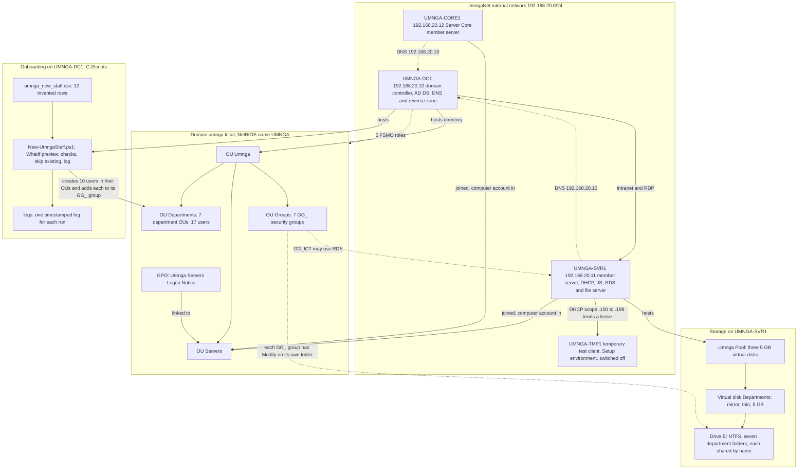

# Umnga IT Infrastructure Lab

A small Windows Server 2025 environment for a made up municipality, built in a personal VirtualBox lab. Each project adds a layer on top of the one before: servers, directory and policy, everyday services, file storage and automation. Every README records what I built, why I chose it, what I saw, and what I did not test.

Umnga Local Municipality is fictional. It has about 60 office staff in seven departments: Municipal Manager's Office, Finance, Corporate Services, Community Services, Technical Services, Planning and Economic Development, and ICT. It is not based on any real municipality. The domain is umnga.local (NetBIOS name UMNGA). No employer systems, tenants or data are used anywhere in this repository, and every person in it is invented.

## What exists now

Three servers on an isolated network, one domain, seven departments with their own groups and file shares, and a PowerShell script that onboards new staff from a CSV file. The domain holds 17 users. All five projects are complete.

## Architecture

## Projects

| No. | Project | What it delivers |
|---|---|---|
| 01 | [IT foundation](01%20IT%20foundation) | Three named, addressed and baselined servers and a naming and IP standard |
| 02 | [Identity and policy](02%20Identity%20and%20policy) | A domain with DNS, OUs, groups, users, a logon notice policy and a read of the FSMO roles |
| 03 | [Core services](03%20Core%20services) | Reverse DNS, DHCP, an internal web page and Remote Desktop Services for the ICT group |
| 04 | [Departmental file server](04%20Departmental%20file%20server) | A mirrored storage pool and seven department shares locked down with NTFS |
| 05 | [Onboarding automation](05%20Onboarding%20automation) | A PowerShell script that creates new staff from a CSV, safely and repeatably |

All five projects share the [naming and IP standard](docs/Naming%20and%20IP%20standard.md), which grew with them.

## The story so far

### 01 IT foundation

ICT started with rules before machines. I wrote a naming and IP standard, then built three servers to follow it: UMNGA-DC1 and UMNGA-SVR1 with the full desktop, and UMNGA-CORE1 as a Server Core machine with no desktop. Each got a fixed address on UmngaNet, the South African time zone and a clean snapshot. The first problems were a VM attached to the wrong network, a firewall that blocks ping by default, and a menu tool that did not apply an address. I diagnosed and logged each one.

### 02 Identity and policy

UMNGA-DC1 became the first domain controller of umnga.local, with DNS on the same server. The directory follows the municipality: a top OU called Umnga, one OU for each department, and places for servers and groups. Each department has a global security group and an invented user, so permissions can later go to groups instead of people. Both member servers joined the domain. One Group Policy Object, a legal notice shown at sign in, is linked to the Servers OU only, and gpresult and the sign in screen show it arrived. With one domain controller, DC1 holds all five FSMO roles. The lab keeps umnga.local, and the README explains why a real organisation would choose differently.

### 03 Core services

A reverse lookup zone closed a gap in the DNS. UMNGA-SVR1 became the DHCP server for 192.168.20.100 to .199, authorised in the directory. To test it, I booted a temporary machine into Windows Setup without installing it, and it received the first address in the pool. IIS publishes an internal page that staff reach as intranet. Remote Desktop Services lets the ICT group, and only that group, open a session on the server. Two sign in errors are logged, one diagnosed and one not.

### 04 Departmental file server

I pooled three small virtual disks with Storage Spaces and made a mirrored, thin provisioned disk from them, formatted as drive E:. The console wizards offered only one of the three disks, so PowerShell finished the job. Each of the seven departments has a folder and a share. The real lock is NTFS: inheritance is off, the broad entries are removed, and only that department's group has Modify. A check with the Effective Access tab showed that a Finance user could change files in the Finance folder and a Planning user could not open it. That was a calculation and not a real sign in. A mirror on one laptop drive shows the design and protects nothing.

### 05 Onboarding automation

Creating accounts was the most repeated job, so I turned it into a script. New-UmngaStaff.ps1 reads a CSV of new staff. For each row it checks that the department OU and group exist and that the user does not, then creates the user, adds the user to the department group and forces a password change at first sign in. It previews with WhatIf, skips existing users, reports a bad row and carries on, and writes a timestamped log. I tested it with a twelve row list that held one existing user and one department that does not exist. The preview said it would create ten, the real run created ten, and the second run created none and skipped eleven. The directory then held 17 users.

## How each project is laid out

Every project folder has the same parts:

1. README.md: the scenario, objectives, the state at the end, design decisions with reasons, build steps with what I saw, verification and limitations
2. evidence: screenshots and a captions file
3. Troubleshooting log.md: what broke, what caused it, how I fixed it, and what I did not record
4. scripts: only where I wrote and ran a script (project 05)

Each README has a Limitations section. I list what I did not test, such as a real sign in or a failed mirror disk, and I do not let a calculation or a console view stand in for a test.

## Planned follow ups

1. Test DHCP, the department shares and a new user sign in from a Windows 11 client, which does not exist in the lab yet.
2. Add a project on server care: updates, event logs, a performance baseline, firewall, Defender, and backup with a restore test.

## Safety rules for this repository

1. No passwords, licence keys, employer data or personal data.
2. I blur or crop screenshots before I commit them.
3. Evaluation media only. No product keys appear anywhere.
4. Any later cloud work uses a free or trial test tenant only.
